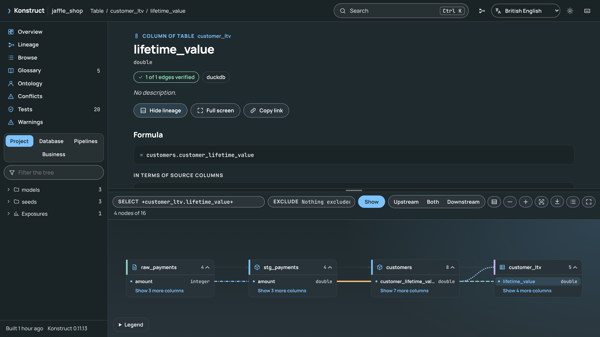
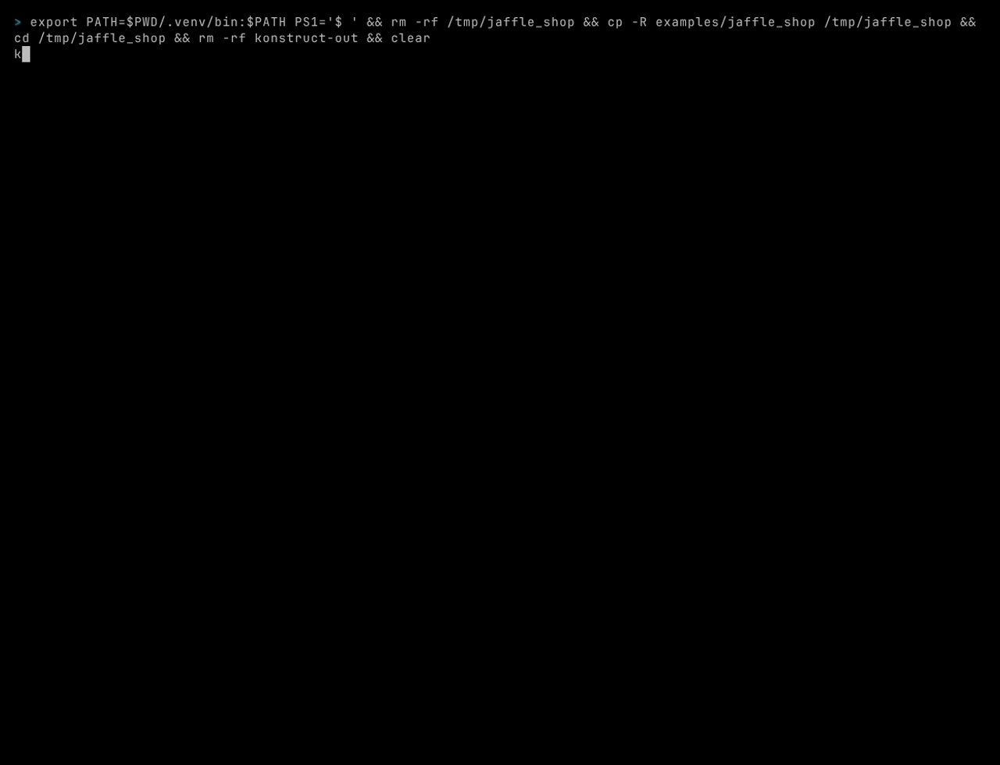

<p align="center">
<a target="_blank" href="https://kodexlabs.io/"></a>
</p>
<p align="center">
<a href="https://github.com/kodexlabsio/konstruct/actions/workflows/build-and-test.yml"></a>&nbsp;<a href="https://github.com/kodexlabsio/konstruct/actions/workflows/release.yml"></a>&nbsp;<a href="./LICENSE"></a>&nbsp;
</p>
<div align="center">

[](https://m8ven.ai/mcp/kodexlabsio-konstruct-rozbrk?s=readme)

</div>
<p align="center">
<a href="https://kodexlabs.io/" target="_blank">Kodex Labs</a> Ltd.
</p>


<h1 align="center">Konstruct</h1>

<h3 align="center">The open context layer AI agents can trust.</h3>

<p align="center">
A self-building ontology of your business, read from the code you already have, with its SQL lineage proven against your data.<br />
Open source, local first, one command.
</p>

<p align="center">
<a href="https://kodexlabsio.github.io/konstruct/"><strong>Documentation</strong></a>
&nbsp;&middot;&nbsp;
<a href="https://kodexlabsio.github.io/konstruct/getting-started.html">Getting started</a>
&nbsp;&middot;&nbsp;
<a href="https://kodexlabsio.github.io/konstruct/guide/github-action.html">GitHub Action</a>
&nbsp;&middot;&nbsp;
<a href="https://kodexlabsio.github.io/konstruct/reference/cli.html">Commands</a>
&nbsp;&middot;&nbsp;
<a href="CHANGELOG.md">Changelog</a>
&nbsp;&middot;&nbsp;
<a href="https://kodexlabsio.github.io/konstruct/paper/konstruct.pdf">Paper</a>
&nbsp;&middot;&nbsp;
<a href="MANIFESTO.md">Manifesto</a>
</p>

<p align="center">

</p>

**AI agents are confidently wrong about your business.** 57% of the enterprises surveyed had traced a confident but wrong answer from an AI agent to missing or inconsistent business context in the previous six months ([VentureBeat, 2026](https://venturebeat.com/data/57-of-enterprises-have-watched-ai-agents-be-confidently-wrong-the-fix-is-an-agentic-context-layer-but-who-has-one), a VB Pulse survey of 101 enterprises in June 2026). An agent sees tables and columns. It does not see that `revenue` has an approved definition with a required filter, that finance and marketing compute it two different ways, or which dashboards its change is about to break.

The answer taking shape is a context layer: a model of the business that agents read before they act. Microsoft ([Fabric IQ ontology over MCP](https://learn.microsoft.com/en-us/microsoft-copilot-studio/mcp-fabric-iq-ontology)), Snowflake ([Horizon Context](https://docs.snowflake.com/en/user-guide/snowflake-horizon/horizon-context)) and Databricks ([Unity Catalog semantics](https://docs.databricks.com/aws/en/business-semantics)) are each building one, each as part of its own platform, and [Palantir's Ontology](https://www.palantir.com/docs/foundry/ontology/overview/) models a business as objects, properties and links inside Palantir's proprietary platform.

**Konstruct is an open context layer that proves itself.** It reads your repository and your warehouse and builds the ontology of your business on every build: the entities and their keys, the metrics with their formulas composed down to source columns, the business definitions with their owners, and the relationships between them. The entities, keys and relationships are derived from the code and its tests; the metrics and definitions come from `definitions.yml`, Apache Ossie models and the ontology packs. Then Konstruct checks its SQL lineage and formulas against the data, guards the model on every change, and serves it to any agent that speaks MCP. It runs locally, with no server and no account, over DuckDB, Postgres, Snowflake, BigQuery, Databricks, Trino and Iceberg alike.

## A Self-Building Ontology

One command derives it from what you already have: dbt, SQL, Airflow, Dagster, Spark, Looker, Power BI and the warehouse itself.

- **Entities** from the keys your tests and constraints guarantee: a `unique` test on `customer_id` makes *customer* an entity.
- **Relationships** from `relationships` tests and joins, many-to-one or one-to-one where a key is tested.
- **Metrics** named in `definitions.yml`, an Ossie model or a pack, each with its formula composed through every model down to source columns.
- **Definitions** with their owner, approval status, grain and required filters, from `definitions.yml`, SKOS and OWL vocabularies and Apache Ossie models.
- **274 ontology packs** for the systems teams land, from Stripe and Salesforce to Zendesk and Google Ads, bound automatically when their tables are in the warehouse, so their entities, metrics and relationships arrive with no configuration.

On the bundled jaffle_shop example, after `konstruct verify`:

```text
$ konstruct ontology
Ontology: 3 entities, 2 measures, 2 relationships and no rule violations.

Entities (3)
  customer  key customer_id  customers, stg_customers  term 'Customer'
  order     key order_id     orders, stg_orders
  payment   key payment_id   stg_payments

Measures (2)
  Customer lifetime value  approved  Priya Shah (Head of Finance), one row per customer
    customer_ltv.lifetime_value        = SUM(raw_payments.amount / 100)  verified 3/3
    customers.customer_lifetime_value  = SUM(raw_payments.amount / 100)  verified 2/2
  Order amount  approved  Priya Shah (Head of Finance), one row per order
    orders.amount  = SUM(raw_payments.amount / 100)  verified 2/2

Relationships (2)
  order -> customer  many-to-one  orders.customer_id = customers.customer_id   tested
  payment -> order   many-to-one  stg_payments.order_id = stg_orders.order_id
```

Every build writes it to `ontology.yml`, `konstruct export ossie` writes it as an Apache Ossie model, and `konstruct search --meaning` finds a column by what it means, so a search for "revenue" finds `net_sales_amt`.

## Proven, Not Just Retrieved

Having a context layer is not the same as having a right one. Of the enterprises able to say, those running or building a governed context layer report confident wrong answers recurring at 50%, against 21% without one; VentureBeat reads this as the layer making failures visible, and warns that "a clean record is not evidence of a healthy context layer" ([VentureBeat, 2026](https://venturebeat.com/data/enterprises-with-ai-context-layers-report-agent-failures-at-more-than-twice-the-rate-of-those-without-one), a VB Pulse survey of 101 enterprises in July 2026). Konstruct checks its own context against the data:

- **Lineage, on the data.** `konstruct verify` perturbs each input column, reruns each model and records what moves. On dbt Labs' jaffle-shop all 87 claimed column edges are confirmed, and nothing moved that the graph did not predict.
- **Formula identity.** Two columns that claim the same metric are compared by what they compute, not how they are written: `SUM(price * quantity)` and `SUM(quantity * price)` are one formula, and `konstruct conflicts` shows where two that differ give different results.
- **Data laws.** Totals a model's SQL must conserve, such as `SUM(daily_revenue.revenue) = SUM(raw_payments.amount)`, are proposed from the SQL and confirmed on the warehouse, through the Python API.
- **Mutation testing.** `konstruct verify --mutate` runs small wrong versions of each model and shows which ones your tests would let through, and suggests a test that would catch each.
- **The rows behind a number.** `konstruct verify --why` lists the source rows behind one value, each with its share, and the rows a filter or join left out.

## Governed on Every Change

- `konstruct gate` fails a change that removes a column something still reads, changes the meaning of an approved definition, or computes a business idea differently from an existing column. The GitHub Action runs it on pull requests (`gate: true`) and comments with what the change does to each column.
- `konstruct history` shows when a metric's formula changed, in which commit, and whether its definition was approved after the change.
- `konstruct trust` keeps a build of an unreviewed checkout from running its code or using its connections: its own warehouse connections are used, and its dbt project run, only after you review and trust it.

## Served to Your Agents

- **An MCP server** that gives agents the ontology, the approved definition of a term, a column's formula and what a change would break. Every tool declares what it does through MCP's annotations, and marks text from the repository as data to report, not instructions to follow.
- **Workflow skills** for Claude Code, Cursor, Codex, GitHub Copilot, Gemini CLI and Windsurf: a safe change, reviewing a data change, reconciling two numbers, writing a correct query, defining terms, onboarding and exporting to a semantic layer.
- **A Claude Code plugin** with the skills, slash commands, a data-reviewer subagent and the MCP server.
- **A Claude Code hook** that runs the gate after each edit to SQL or dbt YAML, so the agent sees what it broke as soon as it breaks it.

## The Engine Underneath

Under the ontology is column-level lineage. It is read from the code itself (SQL, LookML, DAX) rather than guessed from names, composed through every model upstream, so `customer_ltv.lifetime_value` reads as `SUM(raw_payments.amount / 100)`, and, for SQL, checked against the data. One chain runs from the table Fivetran landed, through dbt, Airflow and Dagster, to the Looker field and the Power BI measure on the dashboard, and across repositories that share a warehouse.

## On the Shoulders of Giants

Konstruct builds on the best open-source work in data: [sqlglot](https://github.com/tobymao/sqlglot) parses and transpiles every major SQL dialect, [dbt](https://www.getdbt.com/) defines how modern transformation is written, [DuckDB](https://duckdb.org/) runs verification on your laptop, [OpenLineage](https://openlineage.io/) is the open standard it writes, and [Apache Ossie](https://ossie.apache.org/) (incubating) the one it reads and writes. What none of them has, and Konstruct adds, is one ontology across all of them, from the table Fivetran landed to the Power BI measure on the dashboard, with the lineage beneath it verified on the data.

## Built For

| | |
|---|---|
| **AI and agent teams** | Agents that reason over the business, not over tables: the ontology, approved definitions and their required filters over MCP, workflow skills for six coding agents, and a gate that checks each Claude Code edit |
| **Analytics engineering** | Refactor with a safety net: `impact` before a change, a column-by-column review on every pull request, and `gate` failing the pull request check when a removed column is still read downstream |
| **Data governance** | Provenance you can prove: column lineage verified on the data, owners and approval status on business terms, and exports to OpenLineage and Apache Ossie |
| **Finance and metric owners** | One number, one definition: `conflicts` finds the same measure computed two ways, and `history` shows when a formula changed and whether anyone approved it |

## The Cost of Not Knowing

Poor data quality is expensive, by the industry's own surveys, most of them by vendors who sell a remedy. Each figure is the source's own; the sentence after it says what Konstruct does in that area.

**USD 12.9 million a year.** That is what poor data quality costs the average organisation, at least ([Gartner, 2020](https://www.gartner.com/en/data-analytics/topics/data-quality)). Konstruct shows the source columns a number is computed from, and every column it reaches.

**Two days in every five.** Data professionals spend 40% of their time checking data quality ([Monte Carlo and Wakefield, 2022](https://tdwi.org/articles/2022/08/09/data-engineers-and-bad-data-survey.aspx)). Konstruct answers "what breaks if I change this?" in one command, before the change ships.

**67 incidents a month, 15 hours each.** And 74% of the data professionals surveyed say the business finds issues first, all or most of the time ([Monte Carlo and Wakefield, 2023](https://tdwi.org/articles/2023/05/04/data-downtime-nearly-doubled-survey.aspx)). Konstruct's gate fails the pull request when a removed column is still read downstream.

**6% of annual revenue.** That is what large firms report losing to AI models trained on low-quality data ([Fivetran and Vanson Bourne, 2024](https://www.fivetran.com/blog/new-ai-survey-poor-data-quality-leads-to-406-million-in-losses)). Konstruct checks its SQL lineage against the data itself, by perturbation.

**60% of AI projects without AI-ready data.** Gartner predicts organisations will abandon them through 2026 ([Gartner, 2025](https://www.gartner.com/en/newsroom/press-releases/2025-02-26-lack-of-ai-ready-data-puts-ai-projects-at-risk)). Konstruct hands agents the entities, measures, definitions and required filters of your data over MCP.

**EUR 15 million or 3% of turnover.** That is the maximum fine for breaching the EU AI Act's high-risk obligations, which include data governance; for smaller firms, the lower of the two ([EU AI Act, Article 99](https://ai-act-service-desk.ec.europa.eu/en/ai-act/article-99)). Konstruct shows where each column comes from, who owns the business term bound to it, and, from git history, when its formula changed.

## What Changes With Konstruct

**Agents get context instead of guessing.** In data.world's benchmark of 43 insurance questions, GPT-4 answered 16.7% correctly over the raw SQL schema and 54.2% over a knowledge graph of the business ([data.world, 2023](https://arxiv.org/abs/2311.07509)). In dbt Labs' 2026 benchmark, text-to-SQL scored 64.5% on the raw schema and 84.1% to 90.0% on the modelled project, and queries through the dbt Semantic Layer 98.2% to 100% ([dbt Labs, 2026](https://docs.getdbt.com/blog/semantic-layer-vs-text-to-sql-2026)). Konstruct gives agents the same kind of context, derived from the code you already have: the entities, keys, measures, relationships and approved definitions, served over MCP.

**Reading every model downstream becomes a query.** "What breaks if I change this column?" takes about 9 ms on a generated 2,000-model project once the graph is loaded, as the MCP server and the Python API keep it, and about half a second of CPU time from the command line. With the GitHub Action it is asked again on every pull request, before anything ships.

**Claims become evidence.** On the bundled example, every one of its 36 claimed column edges is confirmed against the data, and 300 generated queries on generated data leave nothing unexplained. A lineage graph you can prove is one an auditor, a regulator or an agent can rely on.

**An illustration, not a measurement.** At the UK median advertised data engineer salary of GBP 70,000 ([IT Jobs Watch, six months to November 2026](https://www.itjobswatch.co.uk/jobs/uk/data%20engineer.do), salary only), the 40% of time that Monte Carlo's 2022 survey reports for checking data quality would be GBP 280,000 a year for a ten-person team.

## Why Konstruct

<table>
<tr>
<td width="50%" valign="top">

### How a column is calculated

`konstruct explain` composes a column's SQL through every model upstream, so `customer_ltv.lifetime_value` reads as `SUM(raw_payments.amount / 100)`, with the joins and filters of each step beside it.

<sub><a href="https://kodexlabsio.github.io/konstruct/guide/explain.html">Explaining a column</a></sub>

</td>
<td width="50%" valign="top">

### Lineage checked against the data

`konstruct verify` perturbs each input column, reruns each model and records what changes. On dbt Labs' jaffle-shop, all 87 claimed column edges are confirmed and nothing changed that the graph did not predict.

<sub><a href="https://kodexlabsio.github.io/konstruct/guide/verify.html">How much to trust the lineage</a></sub>

</td>
</tr>
<tr>
<td width="50%" valign="top">

### Pull requests reviewed column by column

`uses: kodexlabsio/konstruct@v0` comments with what a change does to each column, ignores formatting and renamed CTEs, and fails the check when a removed column is still read downstream.

<sub><a href="https://kodexlabsio.github.io/konstruct/guide/github-action.html">The GitHub Action</a></sub>

</td>
<td width="50%" valign="top">

### Business definitions beside the lineage

`definitions.yml` records what each term means, who owns it and which columns hold it. Agents get the approved definition, and the build warns when a bound column disappears. Konstruct derives an ontology of entities, measures and relationships from them, and reads and writes Apache Ossie semantic models: a model it reads is written back as authored, with each metric's lineage and trust added.

<sub><a href="https://kodexlabsio.github.io/konstruct/guide/definitions.html">Business definitions</a></sub>

</td>
</tr>
<tr>
<td width="50%" valign="top">

### Conflicting definitions found

`konstruct conflicts` finds the same measure computed in different ways, such as two revenue columns that differ by one filter, and shows exactly what differs and in which file.

<sub><a href="https://kodexlabsio.github.io/konstruct/guide/conflicts.html">Finding conflicting definitions</a></sub>

</td>
<td width="50%" valign="top">

### One chain across tools

A column computed in dbt, copied by an Airflow SQL task, written by a Dagster asset and shown on a dashboard is one chain, through DuckDB, Postgres, Snowflake, BigQuery, Databricks, Trino and Iceberg, and across repositories.

<sub><a href="https://kodexlabsio.github.io/konstruct/guide/inputs.html">Inputs and how lineage works</a></sub>

</td>
</tr>
</table>

## Quick Start

Konstruct is not on PyPI yet; install it from GitHub with [uv](https://docs.astral.sh/uv/):

```bash
uv tool install git+https://github.com/kodexlabsio/konstruct
```

Installing from GitHub compiles Konstruct, so it needs a [Rust toolchain](https://rustup.rs/) (1.95
or newer); each [release](https://github.com/kodexlabsio/konstruct/releases) also has wheels for
Linux, macOS and Windows that do not. Konstruct runs on x86_64, aarch64, riscv64, ppc64le, s390x
(IBM z13 or later) and loongarch64.

Then, in a repository with dbt models, SQL, DAGs or a warehouse:

```bash
konstruct build                         # writes konstruct-out/: graph.json, REPORT.md, graph.html, ontology.yml
konstruct impact stg_payments.amount    # everything downstream of a column
konstruct explain orders.amount         # how a column is calculated, down to its sources
konstruct history orders.amount         # when its formula changed, and who approved it
konstruct open                          # the interactive graph in a browser
konstruct ontology                      # entities, measures and how they relate
konstruct relate customer payment       # how two entities join, and how far to trust it
konstruct install                       # the Konstruct skills for Claude Code and Cursor (--agent all for every agent)
```

No configuration is needed: Konstruct finds dbt projects, Airflow and Dagster files, SQL, definitions and the warehouse each dbt profile points at. [Getting started](https://kodexlabsio.github.io/konstruct/getting-started.html) covers extras, pinning a release and the bundled example.

<p align="center">

</p>

## The Evidence

Lineage tools usually assert their lineage. Konstruct measures it, and every number here is a test that runs on every commit.

| Lineage checked against the data (seed 1729) | Claimed column edges | Confirmed | Unexplained |
|----------------------------------------------|---------------------:|----------:|------------:|
| The bundled `jaffle_shop` example | 36 | 36 | 0 |
| dbt Labs' jaffle-shop, at a pinned commit | 87 | 87 | 0 |
| The example on Postgres | 31 | 31 | 0 |
| Generated queries on generated data (25 on every commit, 300 in a full run) | | | 0 |

| Generated dbt project | Column edges | Cold build | Update, one model edited | Query |
|----------------------:|-------------:|-----------:|-------------------------:|------:|
| 500 models | 12,940 | 5.4 s | 1.1 s | 0.4 ms |
| 2,000 models | 51,940 | 20.7 s | 5.9 s | 1.3 ms |

Composed formulas are evaluated on the data and must match the final model row for row; the static Airflow and Dagster parsers are compared with Airflow's and Dagster's own graphs; and OpenLineage exports are validated against the specification. [Performance](https://kodexlabsio.github.io/konstruct/performance.html) and [verification](https://kodexlabsio.github.io/konstruct/guide/verify.html) give the details.

## Inputs

| | |
|---|---|
| **Transformation** | dbt (manifest, catalog, or rendered without dbt), standalone SQL files, the SQL in PySpark jobs, warehouse views |
| **Orchestration** | Airflow (DAGs, TaskGroups, TaskFlow, assets, Cosmos) and Dagster (assets, op jobs, schedules, sensors), parsed without running them |
| **Warehouses** | DuckDB, Postgres, Snowflake, BigQuery, Databricks, Trino, and Iceberg through any PyIceberg catalogue |
| **Dashboards** | dbt exposures, Looker views field by field from LookML, and Power BI semantic models from TMDL |
| **Ingestion** | The tables two dozen loaders land, known by the marks each leaves or a dbt source's `loader:` (Fivetran, Airbyte, dlt, Singer, Meltano, Stitch, Debezium, Datastream, Openflow, Estuary, Segment, Snowplow and more), and lineage from the source systems in Fivetran's lineage tables, dlt's `_dlt_version`, dlt pipelines, `meltano.yml`, Singer catalogs, Airbyte connections, Fivetran and Airbyte Terraform, Debezium and Kafka Connect connectors, Estuary catalogs, Sling replications, Lakeflow Connect bundles and DMS table mappings |
| **Meaning** | Business terms in `definitions.yml` and SKOS or OWL vocabularies, with a concept hierarchy, 274 ontology packs for the source systems teams land (Stripe, Shopify, Salesforce, HubSpot, Zendesk, Jira, Google Ads and hundreds more) bound automatically, and column usage from Snowflake, BigQuery and Databricks query history |

## Features

Try the [live demo](https://kodexlabsio.github.io/konstruct/demo/): the viewer for the jaffle_shop example, rebuilt from main with the documentation.

### Ontology

- `konstruct ontology`: the entities and their keys, the measures with their composed formulas, and the relationships between entities, with cardinality where a key is tested, checked against rules that `--strict` turns into a failing build ([the ontology](https://kodexlabsio.github.io/konstruct/guide/ontology.html)).
- `konstruct entity`, `konstruct metric` and `konstruct relate`: one entity with its properties, relationships and metrics; every metric with its formula, grain, filters, owner and status, from `definitions.yml`, dbt's semantic layer, Looker and Power BI, and those Konstruct proposes from aggregate and measure columns where nothing defines one, marked inferred and never approved; and how two entities join, with the SQL. Every entity, metric and relationship says whether it is verified against the warehouse, declared or only inferred ([entities, metrics and relationships](https://kodexlabsio.github.io/konstruct/guide/ontology.html#entities-metrics-and-relationships)).
- `konstruct define`: the approved business definition of a term from `definitions.yml`, with its owner, status, grain, required filters and bound columns ([business definitions](https://kodexlabsio.github.io/konstruct/guide/definitions.html)).
- 274 ontology packs for the source systems teams land, from Stripe, Shopify, Salesforce, HubSpot and GA4 to Zendesk, Jira and Google Ads, bound automatically when their tables are in the warehouse ([ontology packs](https://kodexlabsio.github.io/konstruct/guide/ontology.html#ontology-packs)).
- SKOS and OWL vocabularies read as terms, with a concept hierarchy.
- Apache Ossie semantic models read as an input and written as an export, with each metric's lineage and trust added ([Ossie](https://kodexlabsio.github.io/konstruct/guide/ossie.html)).
- `konstruct search --meaning`: find a column by what it is, not only what it is called: "revenue" finds `net_sales_amt` through abbreviations, synonyms, its formula and its lineage, computed locally from the graph.
- Column usage from Snowflake, BigQuery and Databricks query history, so the columns people read stand out ([usage](https://kodexlabsio.github.io/konstruct/guide/usage.html)).

### Proof

- `konstruct verify`: lineage checked against the data by perturbation, on DuckDB, Postgres and samples of Snowflake, BigQuery, Databricks and Trino, and on DuckDB and Postgres the ontology's keys and relationships checked over whole tables, read only ([verify](https://kodexlabsio.github.io/konstruct/guide/verify.html)).
- `konstruct verify --mutate`: mutation testing for dbt tests: small changes to each model's SQL are run against its data and unit tests, read only, with a score per model and column and a suggested test for each change the tests miss ([mutation testing](https://kodexlabsio.github.io/konstruct/guide/verify.html#mutation-testing)).
- `konstruct verify --why`: the source rows behind one value, such as one customer's lifetime value, each with its share, and the related rows a filter or join left out, with the reason ([the rows behind a value](https://kodexlabsio.github.io/konstruct/guide/verify.html#the-rows-behind-a-value)).
- `konstruct verify --effect`: what each formula change does on today's data: the changed model's SQL before and after each commit, run read-only on the same rows, so a moved number is split into a definition change and a data change ([the effect on today's data](https://kodexlabsio.github.io/konstruct/guide/release-notes.html#the-effect-on-todays-data)).
- `konstruct conflicts`: the same measure computed in different ways, and exactly what differs. Formulas are compared by what they compute, not how they are written, and two that differ come with values at which they give different results ([conflicts](https://kodexlabsio.github.io/konstruct/guide/conflicts.html)).
- `konstruct verify --laws`: the totals the lineage says the data must keep (a mart's revenue equals its source's under the same filters and unit conversion, a model that maps rows one to one keeps the row count, and which measures may be summed), proposed from each model's SQL only where its joins are proven safe and checked per day, read only; the gate fails a change that breaks one ([data laws](https://kodexlabsio.github.io/konstruct/guide/verify.html#data-laws)).

### Governance

- `konstruct diff`: what a branch does to each column, ignoring formatting and renamed CTEs, and the `dbt build --select` that rebuilds exactly what it changes ([reviewing changes](https://kodexlabsio.github.io/konstruct/guide/reviewing-changes.html)).
- `konstruct gate`: the check a coding agent passes before it proposes a change, and CI before it merges. It fails on a removed column something still reads, an approved definition whose meaning changed, a new column that computes a business idea differently from an existing one, and a data law the change breaks.
- A [GitHub Action](https://kodexlabsio.github.io/konstruct/guide/github-action.html) that comments on each pull request, annotates breaking changes and fails the check when a removed column is still read.
- `konstruct history`: when a column's formula changed, in which commit, and whether its definition was approved after the change.
- `konstruct release-notes`: a change log of formulas, filters and business terms since a tag or date, each change in SQL and plain English with its commit, what it affects downstream and whether its terms were approved after it, as text, Markdown or JSON ([release notes](https://kodexlabsio.github.io/konstruct/guide/release-notes.html)).
- `konstruct trust`: a repository's own warehouse connections and paths outside it are used, and its dbt project run, only after you review and trust it, and again after each change to those settings, so building an unreviewed checkout runs none of its code and sends no environment variable to a host it chose ([trust](https://kodexlabsio.github.io/konstruct/reference/configuration.html#trusting-a-projects-connections)).

### Agents

- Coding agents: `konstruct install` writes Konstruct's skills for the agents `--agent` names (Claude Code, Cursor, Codex, GitHub Copilot, Gemini CLI and Windsurf), with instructions or rules in each agent's own format (a managed section of `AGENTS.md`, `GEMINI.md` or `copilot-instructions.md`, or a Cursor or Windsurf rule), and with `--mcp` registers the MCP server in each agent's configuration ([coding agents](https://kodexlabsio.github.io/konstruct/guide/agents.html)). `konstruct mcp` runs the [MCP server](https://kodexlabsio.github.io/konstruct/reference/mcp.html), whose tools are `impact`, `trace`, `path`, `search`, `describe`, `query`, `explain`, `history`, `define`, `conflicts`, `ontology`, `entity`, `metric`, `relate`, `diff`, `gate`, `check_sql`, `check_history`, `release_notes`, `mutation_test`, `why`, `definition_effect`, `receipt` and `laws`, with seven prompts for the workflows and three resources: the report, the ontology and a summary of the graph. Every tool declares the four MCP tool annotations, and every result marks the repository's text as data to report, not instructions to follow.
- `konstruct check-sql`: the SQL an agent writes, checked against the project before it runs, without running it: a measure that leaves out a filter its approved definition requires or computes it differently, a retired column, a join that repeats the rows a sum or count adds up, and names the project does not have, each with its fix and the corrected SQL. `--history` finds the same mistakes in the queries people already run in Snowflake, BigQuery and Databricks ([checking SQL](https://kodexlabsio.github.io/konstruct/guide/agents.html#checking-the-sql-an-agent-writes)).
- `konstruct receipts`: a receipt for an answer, recording the formulas, row conditions, sources, business terms and verification state of the columns it rests on and the build it came from, and `konstruct receipts check`, which lists the answers whose basis has changed since, with the commit that changed it ([answer receipts](https://kodexlabsio.github.io/konstruct/guide/receipts.html)).
- Eight skills: `konstruct` for questions, and workflows for a safe change, reviewing a data change, reconciling two numbers, writing a correct query, defining terms, onboarding to a repository and exporting to a semantic layer.
- A Claude Code plugin (`/plugin marketplace add kodexlabsio/konstruct`, then `/plugin install konstruct@konstruct`) with the skills, the `/konstruct:impact`, `/konstruct:review`, `/konstruct:gate`, `/konstruct:explain` and `/konstruct:define` commands, a data-reviewer subagent and the MCP server.
- `konstruct hook`: a PostToolUse hook that runs the gate after an agent edits SQL or dbt YAML and gives it the findings, building from files alone without dbt or a warehouse.

### Lineage, the engine underneath

- `konstruct impact` and `konstruct trace`: everything downstream or upstream of a table or column, through dbt models, SQL files, warehouse views, Airflow and Dagster tasks, PySpark jobs, loaders and dashboards, with the transform at each step.
- `konstruct path`: how two tables or columns are connected.
- `konstruct explain`: a column's formula composed through every model upstream, down to source columns, with the joins and filters on the way; `--english` words it, its conditions, grain and terms in plain English by a fixed grammar, so the sentence says only what the SQL says ([in plain English](https://kodexlabsio.github.io/konstruct/guide/explain.html#in-plain-english)).
- `konstruct build --update`: an incremental rebuild that reanalyses only what changed.
- `konstruct search`, `konstruct describe`, `konstruct list` and `konstruct query`: find anything in the graph by name, inspect one node, list a kind, or ask in plain words.
- One graph across repositories that share a warehouse, and across warehouses.

### Where else to use it

- The command line: `konstruct init`, `konstruct build`, `konstruct status`, `konstruct open` and every command above, the commands that answer a question with `--json` output for scripts ([every command](https://kodexlabsio.github.io/konstruct/reference/cli.html)), versioned so that scripts keep working from one release to the next ([compatibility](https://kodexlabsio.github.io/konstruct/reference/outputs.html#compatibility)).
- Python: `konstruct.Project`, with [typed results](https://kodexlabsio.github.io/konstruct/reference/python-api.html) for every question.
- A browser: `graph.html`, [one offline documentation site](https://kodexlabsio.github.io/konstruct/guide/viewer.html) with a page for every model, column, task and business term (its SQL, tests and formulas), a lineage graph that takes dbt selectors down to columns, a map of the whole project at once, search, and an overview of coverage and conflicts, in 14 languages and checked against WCAG 2.2 AA with axe-core; `REPORT.md` and `ontology.yml` sit beside it for reading in a repository.
- A local server: `konstruct serve` serves the viewer with live reload and a read-only, versioned JSON API with an OpenAPI document ([the HTTP API](https://kodexlabsio.github.io/konstruct/reference/http-api.html)).
- Other tools: `konstruct export` writes OpenLineage events, Mermaid, Graphviz DOT, CSV and Apache Ossie ([exporting](https://kodexlabsio.github.io/konstruct/guide/exporting.html)).
- Plugins: installed Python packages add inputs, export formats, gate checks, ontology packs and MCP tools through entry points, each run only when a project enables it in `konstruct.toml`; `konstruct plugins` lists them ([writing a plugin](https://kodexlabsio.github.io/konstruct/guide/plugins.html)).

## Documentation

The full documentation is at **[kodexlabsio.github.io/konstruct](https://kodexlabsio.github.io/konstruct/)**:

- **Guide:** [inputs and how lineage works](https://kodexlabsio.github.io/konstruct/guide/inputs.html), [the viewer](https://kodexlabsio.github.io/konstruct/guide/viewer.html), [explain](https://kodexlabsio.github.io/konstruct/guide/explain.html), [verify](https://kodexlabsio.github.io/konstruct/guide/verify.html), [reviewing changes](https://kodexlabsio.github.io/konstruct/guide/reviewing-changes.html), [business definitions](https://kodexlabsio.github.io/konstruct/guide/definitions.html), [the ontology](https://kodexlabsio.github.io/konstruct/guide/ontology.html), [Apache Ossie models](https://kodexlabsio.github.io/konstruct/guide/ossie.html), [conflicts](https://kodexlabsio.github.io/konstruct/guide/conflicts.html), [usage](https://kodexlabsio.github.io/konstruct/guide/usage.html), [coding agents](https://kodexlabsio.github.io/konstruct/guide/agents.html)
- **Reference:** [commands](https://kodexlabsio.github.io/konstruct/reference/cli.html), [Python API](https://kodexlabsio.github.io/konstruct/reference/python-api.html), [MCP server](https://kodexlabsio.github.io/konstruct/reference/mcp.html), [configuration](https://kodexlabsio.github.io/konstruct/reference/configuration.html), [outputs](https://kodexlabsio.github.io/konstruct/reference/outputs.html), [limitations](https://kodexlabsio.github.io/konstruct/reference/limitations.html)
- **Project:** [development](https://kodexlabsio.github.io/konstruct/development.html), [contributing](CONTRIBUTING.md), [security](SECURITY.md), [changelog](CHANGELOG.md)
- **Paper:** [Konstruct: Column-Level Lineage Checked Against the Data](https://kodexlabsio.github.io/konstruct/paper/konstruct.pdf), the design, the verification method and its soundness, and the evaluation, with every measurement of Konstruct regenerated from the code
- **Manifesto:** [truth in data](MANIFESTO.md), what Konstruct believes and the commitments it makes to its users

## Star History

<p align="center">
<a href="https://www.star-history.com/#kodexlabsio/konstruct&Date">
<picture>
<source media="(prefers-color-scheme: dark)" srcset="https://api.star-history.com/svg?repos=kodexlabsio/konstruct&type=Date&theme=dark" />
<source media="(prefers-color-scheme: light)" srcset="https://api.star-history.com/svg?repos=kodexlabsio/konstruct&type=Date" />

</picture>
</a>
</p>

## Contributing and Security

Bug reports with a small failing case are the most useful contribution; [CONTRIBUTING.md](CONTRIBUTING.md) explains how to report one or propose a change. [SECURITY.md](SECURITY.md) covers reporting a vulnerability and what Konstruct executes, reads and writes: it never imports DAG code, renders dbt Jinja in a sandbox, makes no requests beyond the warehouses you configure, and collects no telemetry.

## Licence

MIT. See [LICENSE](LICENSE). The generated ontology packs are made from connector schemas under the Apache-2.0 and MIT licences, which [SOURCES.json](konstruct/semantics/ontologies/SOURCES.json) lists repository by repository, and the viewer embeds the Manrope and JetBrains Mono fonts under the SIL Open Font License, so the package's licence expression is MIT AND Apache-2.0 AND OFL-1.1. The jaffle_shop example keeps its own Apache-2.0 licence. The licence texts are in [licenses/](licenses/), each named for what it covers: `konstruct.txt` (Konstruct, the root LICENSE), `ontology-packs-apache-2.0.txt` and `ontology-packs.txt` (the generated packs' sources under Apache-2.0, and each other source's licence with its copyright notice), `manrope.txt` and `jetbrains-mono.txt` (the fonts).
