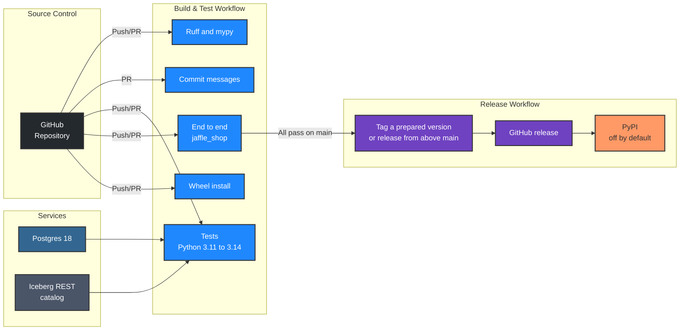

# Development

## Prerequisites

- [uv](https://docs.astral.sh/uv/) (it installs Python 3.12 for the project)
- A stable [Rust toolchain](https://rustup.rs/), 1.95 or newer, for the Rust core; uv fetches maturin itself
- Docker, for the Postgres and Iceberg integration tests
- Node.js 24 (see `.nvmrc`) and [pnpm](https://pnpm.io/), only to work on the graph viewer
- [vhs](https://github.com/charmbracelet/vhs), only to re-record the demo GIFs

## Installation

1. **Clone the repository**
   ```bash
   git clone git@github.com:kodexlabsio/konstruct.git
   cd konstruct
   ```

2. **Install dependencies and the git hooks**
   ```bash
   uv sync
   uv run pre-commit install
   ```
   The hooks run Ruff and mypy before each commit (and the viewer checks when `viewer/` changed), check the commit message, and run the tests before each push.
   `uv sync` also compiles the Rust core, in release mode, into `konstruct/_core.abi3.so` (`_core.pyd` on Windows) in the source tree. uv rebuilds it whenever a file under `src/` changes, the next time `uv sync` or `uv run` runs.

## Tests

```bash
uv run playwright install chromium              # once, for the browser tests
uv run pytest                                   # Postgres and Iceberg REST tests skip without services
eval "$(.kodex/scripts/services.sh up)"         # start them in Docker and export their addresses
uv run pytest --cov                             # everything, with branch coverage (fails under 90%)
.kodex/scripts/services.sh down
```

| Kind | Where | What it checks |
|------|-------|----------------|
| Unit | `test_graph`, `test_sql`, `test_dbt`, `test_airflow`, `test_report`, `test_skill`, ... | Each module, including lineage through CTEs, joins, aliases, `SELECT *`, unions and window functions |
| Reading graph.json | `test_graph_read` | `Graph.read` against the standard library's `json` module read into `Graph.from_dict`: every node, edge, adjacency list, walk, statistic and `to_dict` the same, for every graph in the compatibility corpus, the example, generated projects of 100 and 2,000 models, a hand-edited graph (repeated ids, keys and edges, self-loops, missing nodes, escapes) written five ways, and generated graph documents; documents with values no Konstruct writes (ids that are numbers, origins that are a string, `attrs` that are a list), given and generated, meaning what `Graph.from_dict` makes of them, errors included; edges made only when read, and the same objects however they are reached, while other threads read them; changes after reading; copies, pickles and pickles from before; integers outside 64 bits; newer formats, documents that are not graphs, invalid JSON and UTF-8 with their line and column |
| Property-based | `test_properties` | Invariants on generated inputs with Hypothesis: impact and trace are inverse, lineage matches generated CTE chains in seven dialects, Airflow dependencies match generated DAGs, no text crashes the SQL analysis |
| Integration | `test_warehouse`, `test_build`, `test_cloud_warehouses` | DuckDB, Postgres and Iceberg (SQL and REST catalogs) for real; Snowflake against fakesnow and BigQuery against its emulator; Databricks against a stub; builds of projects with and without dbt |
| End to end | `test_build`, `test_cli`, `test_query`, `test_mcp` | The example built with real dbt, every CLI command, the Python API, and the MCP server in process and over stdio |
| Golden files | `test_golden`, `tests/golden/` | The exact text of the CLI output and REPORT.md; regenerate with `KONSTRUCT_UPDATE_GOLDEN=1` and review the diff |
| Terminal output | `test_terminal` | Colour and its off switches (`NO_COLOR`, `--no-color`, `TERM=dumb`), plain text in pipes, fitting tables and trees to the window, SQL highlighting, the build spinner, errors and grouped help |
| Interfaces | `test_interfaces`, `test_formats`, `tests/golden/interfaces/` | What users build on, as a snapshot: the command line (commands, options with what each takes, positional arguments by position, choices) and its exit statuses, the shape of every `--json` document and of `graph.json` with each one's format version (from the example and small projects that fill every list, bar the few listed with a reason), the MCP tools' inputs, the Python API with each parameter's position, the `konstruct.toml` keys, the GitHub Action's inputs and outputs and the CSV columns; a newer `graph.json` refused with an upgrade message, and reported by `status`. A removed or changed entry fails, and so does a new one until the snapshot is regenerated with `KONSTRUCT_UPDATE_GOLDEN=1`; a deliberate removal is committed with both `!` after the type and a `BREAKING CHANGE:` footer. A JSON field breaks when it is removed, emptied to only `null` or given a type it did not hold (`null` aside, so `str` widened to `null\|str` passes, and so does a field showing fewer of its types); an entry that accepts more than it did is not a break: a required option, positional, MCP argument, Python parameter or Action input made optional, or an MCP argument or Python parameter that takes more types. A list the projects no longer fill, and a field they fill only with `null`, fail as missing coverage unless `EMPTY` or `UNFILLED` lists it with a reason, and the commit check counts the fields gone with them as removed. The command line records each positional's type and how many values it takes, and the default of every option that takes a value, `None` included |
| Compatibility | `test_compat`, `tests/compat/` | The graphs each release built of the example and of an orchestration project (the example with the Dagster and Airflow fixtures), with the `--json` answers that release gave: this code reads each graph, answers every recorded command through the CLI and the MCP server with the same exit status and the same answer (new fields aside, and the deliberate differences listed in `tests/compat/allowed.yml` with their reasons), renders the report and the viewer, and reviews a change with `diff` as it does with its own graph; every release tagged from v0.11.13 up to the newest one in `releases.json` must be in the corpus (CI fetches the tags to check), so releases tagged before a batch fail no pull request |
| Browser | `test_browser` | graph.html in Chromium: pages, column rows and edges, formulas, SQL, routes and old deep links, selectors, full screen, keyboard navigation of the graph, search, export, themes, languages and right-to-left layout, WCAG 2.2 AA with axe-core in both themes and at 200% zoom, full screen and the top bar at narrow widths, Markdown descriptions, deep quotes and cut descriptions, translated selector errors, the Content-Security-Policy, a served page reloading on server-sent events, hostile text, a 1,200-model graph |
| Map | `test_map`, `viewer/tests/map.test.ts` | The map page in Chromium with WebGPU on SwiftShader: drawn pixels, the same layout and pixels on every load, search, the keyboard and the tab order, the list as one tab stop, filters, opening pages and coming back, WCAG 2.2 AA in both themes, the CSP, the message without WebGPU, buffers larger than the device allows, and characters the glyph atlas has no room for; in Vitest, the scene in the lineage page's layout, placement, buffer packing, the camera, picking against a full scan, colours, the distance field, text setting, and the renderer against a fake device's limits and error scopes |
| Usage | `test_usage` | The SQL sent to Snowflake, BigQuery and Databricks, query text parsing for BigQuery, usage on columns, in the report and describe, the daily cache, off by default, and missing permissions as a warning, against stub drivers in each vendor's row shapes |
| Search by meaning | `test_semantic` | A renamed revenue column found through abbreviations, lineage and formulas, synonyms, formulas by their shape, exact names first, `similar`, the index made by the first search and reused, an output directory that cannot be written, lone surrogates; on the example, revenue in other words finding the revenue measures, churn, employee turnover and staff churn rate finding nothing, results that mean most of the question and not only part of it, a surname being a last name, no match by hashing or by noise words, and copies never matched by formula |
| Conflicts | `test_conflicts` | Two revenue definitions that differ by one filter (the pair, the filter and its file), different sources, ranking, grouping by business terms, copies left out, no false conflicts on the example; formulas written differently counted as one when their columns have `not_null` tests and noted as the same unless NULL without them, and as differing where a `not_null` column is read through an outer join (with `ON` and `USING`), and as the join alone where only one route has it; a source difference hiding a formula the same unless NULL; formulas written the same never a formula difference; witnesses in the text, Markdown and JSON |
| Formula identity | `test_identity` | Rewrites that are the same, the same only without NULLs, and different, with the kind of witness; random formulas checked against DuckDB on random tables with NULLs and empty tables, and each witness run in DuckDB; constants that wrapped around a fixed modulus; presences kept whole that collided; columns with `not_null` tests, also read through an outer join, checked in DuckDB; volatile functions; `NOT NOT` only around a predicate; scalar subqueries that may be NULL; a witness that sets an expression shown as no proof; conditions and windows; a fresh key per comparison; lineage cycles and unreadable expressions |
| Ontology | `test_ontology` | Entity names and keys from unique tests, primary keys, identifier fields and grains; terms that name entities; measures and their formulas; relationships, cardinality and `tested`; every rule; the same output whatever the graph's order; the build file, the CLI and the example project |
| Ossie | `test_ossie` | Both Ossie shapes, the build input and its warnings, composite keys and relationships, data types, and an export validated against the Ossie schema, including a metric read from Ossie and written back |
| Ossie portability | `test_ossie_conformance` | Ossie's own M0 to M3 portability ladder (`compliance/portability`): each fixture read through a build, written back and graded element by element in the ladder's outcome vocabulary; every element of the qualified fixtures is PORTABLE and the model comes back as authored, and the bare fixtures' metrics are DROPPED_DIAGNOSED |
| Looker | `test_looker` | LookML views: tables (or the view's own name), the columns each field reads (through other fields, dimension group timeframes and the default ones, own-view references, location and duration SQL, measure filters, cycles), refinements, `extends` (added to by refinements, with a child's own table winning) and abstract views, derived tables, Liquid table names and unknown columns as warnings, column impact reaching only the views that read the column, tables only Looker names, and `[looker] paths` |
| Power BI | `test_powerbi` | TMDL tables, descriptions, columns, measures (one line, several lines, with properties and annotations after them), calculated columns, tabs or spaces, CRLF and a byte order mark; warehouse tables from `Schema`/`Item` and `Name`/`Kind` navigation (fenced M, BigQuery, merged tables), shared expressions, native queries in the connector's dialect (server names in brackets, `#(lf)`, `[Query=...]`), Direct Lake entities and incremental refresh; DAX references across tables, measures on measures (a chain of 400 resolved in time), `VAR` names, calculated columns and comments and strings left out; automatic date tables left out; partitions with no table, native queries reading none, duplicate tables and models as warnings; exposures fed column by column with the fields that read each column; impact reaching only them; unknown columns as warnings; tables only read elsewhere growing the columns named; `--update`; `[powerbi] paths`; `konstruct status` and `init` |
| Definitions | `test_definitions` | The definitions.yml format and its errors, terms in the build, `define`, describe, search, query and impact, the glossary, warnings for missing columns and filters (including a renamed bound column in the example), and `diff` on definitions |
| Formulas | `test_explain` | `explain` on dbt and Airflow SQL, and composed formulas evaluated on the data against the final model, row for row; the viewer's formula cache |
| Export | `test_export` | OpenLineage events validated against the OpenLineage JSON schemas; Mermaid, DOT and CSV |
| Scale | `test_scale` | A generated 300-model project: full build and `--update` times |
| Real world | `test_realworld` | dbt Labs' jaffle-shop at a pinned commit (needs network; `KONSTRUCT_REALWORLD=1`) |
| Lineage against data | `test_verify` | `verify` confirms true lineage and catches removed edges, false edges and dropped filters; a differential property test runs generated queries on generated data and requires the static lineage to agree with execution |
| Gate | `test_gate` | `gate` on real git repositories: a safe change passes; a breaking change, a new meaning for an approved term and a new conflicting column fail, each with its file and fix; a conflict the change does not touch does not; the CLI's exit status, JSON and markdown |
| Repositories | `test_repositories` | Several repositories in one graph: lineage, terms and options across them, a relation one builds and another reads as one node whatever the order of `repositories`, a table read under a shorter name linked only when no other relation ends with it, and a relation two repositories build as a warning |
| Lineage lockfile | `test_lock` | `konstruct.lock` on real git repositories: pins, the file's format and its refusals, formatting and harmless rewrites (a Hypothesis test over conjunct order, brackets, mirrored comparisons, IN lists and decimals), and formula, condition, seed, Python model, type, definition and removed-column changes, each with who made it; filters moved across outer joins, window functions and LIMITs, DISTINCT, UNION and GROUP BY ALL, each confirmed by running both versions in DuckDB; a producer checking its consumers; a new canonical form; `konstruct lock`, `--check`, `--update` and their exit statuses, the `lock_check` MCP tool, and the gate naming a consumer whose pin a change alters but not one whose pin an earlier change left stale, reading no lockfile for a change that alters no column, and an unreadable lockfile failing only a change to what its repository reads |
| Data laws | `test_laws` | Laws proposed only where the SQL keeps a total and confirmed per day on DuckDB and Postgres: a planted fan-out join in the data and in the SQL, each law kind both ways, `UNION ALL` branches, `FULL` joins, tests with a `where`, incremental models, additivity probes, a brute-force oracle, no false law on jaffle_shop; `verify --laws`, `laws.json`, the `laws` MCP tool and the gate naming the model that breaks a law, judging only the steps a change touches, reading an edit dbt has not compiled from its file and the laws committed at the base, saying where they came from; without dbt on jaffle_shop, a macro edit, a removed uniqueness test on a model or a source, a removed package test, a deleted or moved model, the MCP gate's copy, and a SQL-built table broken on the base |
| Change review | `test_diff` | `diff` on real git repositories: formatting and CTE renames are not changes, removed columns still read downstream are breaking, conditions, DAGs, two commits, all output formats, and dbt Jinja rendering |
| PySpark | `test_spark` | The SQL a job passes to `spark.sql` (literals, f-strings without placeholders, concatenations, names bound once), names bound more than once and SQL formatted with keyword arguments as warnings, which files are jobs (Databricks notebooks too) and which objects are sessions (Snowpark files apart), `spark_catalog` left out, column lineage of the tables a job writes, `[spark] paths` and `dialect`, `konstruct status` and `init` |
| Dagster | `test_dagster` | The Dagster parser, assets and op jobs joining dbt and warehouse lineage, sensors ordering work, and parity with Dagster's own asset and job graphs (needs Dagster; see the CI job) |
| Databricks | `test_databricks_live` | The connector against a Databricks workspace with Unity Catalog; runs when workspace credentials are set (see the file) |
| Plugins | `test_plugins` | The example plugin installed from its own entry points: its input read into the graph with column lineage from its SQL, its check in the gate, its pack bound and its MCP tool served, in process and in a fresh CLI process; plugins off until enabled, `--no-plugins` and `KONSTRUCT_NO_PLUGINS`; `konstruct plugins` and `status`; inputs, exports and checks that raise, return the wrong thing, cannot be imported, target another API version, lack part of their protocol or take a name already used, each reported by name and the build going on; fragment validation, including everything that would fail the merge or the write; hostile fragments (lone surrogates in any field, attributes nested too deep or holding NaN, reserved attribute names, `#` in relation and column names, boolean and oversized counts) each refused and odd ones merged, with `impact`, `trace`, `export` and `ontology` working after each; values `context.cached` cannot hold, in a cold build and with `--update`; tool listings whose names are not strings or clash once joined, and counts that clash; the reserved attribute and count names checked against every name the package and the viewer read, through aliases, module constants, loops, `match` mappings and `dict(...)` or `{**...}` wrappers; values the encoder writes but JSON cannot hold as given (dataclasses, dates, enums, UUIDs, keys that are not strings) refused in node and edge attributes; cached values the same in a cold build and an update, and cache keys checked; plugin findings of the wrong type failing the gate as their check; line breaks in names, warnings and findings put on one line; API versions by major and minor; the gate running the checks the base enables after a change drops them; an MCP tool the server cannot describe left out alone; `--no-plugins` and `KONSTRUCT_NO_PLUGINS` alike for `[ontologies] packs`; column ends against known and unknown columns; data-only packs found without importing their package; no entry points read by commands that run no plugin |
| Ontology packs | `test_registry` | Every pack loads with a title, kinds and definitions and no status; every match block picks out its own pack and requires two columns that are not generic; a block of generic table names with fewer than three such columns needing the schema's name; matching by tables, source-only columns and a schema name or loader, singular or plural; a schema named for its source binding two entity tables in any naming (`tap_jira`, `hubspot_dataset`); every matching pack binding, contention, the most specific schema pattern and the tie rule, and optional tables another pack requires or names alike; Stripe, Zendesk and HubSpot streams in one Airbyte schema; Shopify landed by Airbyte in a schema of any name; an application's own tables, replicated by Fivetran, matching nothing; Fivetran's Salesforce history-mode seeds binding no entity or measure; history, report, daily, composite-key and repeating-key tables and stray keys kept out of the entities, and flags, settings, deprecated columns and history tables out of the measures; Google Ads' and Jira's measures from Fivetran's doc blocks; a hand-written term winning in any naming; singular nouns, words run together, acronyms, articles, British spelling, every word of a name and the text of every pack; the licence expression covering every source; binding to a DuckDB warehouse as drafts, with no warnings and no untested cardinality; terms whose tables are missing left out; a project's own term, entity on the same column or synonym winning; `[ontologies] packs`; a pack in two catalogues; GA4's newest daily table, not the intraday or fresh one; two repositories sharing a warehouse |
| Loaders | `test_loaders` | Which tool landed a table, for every mark, with its documentation; application tables with lookalike columns (`op`, `deleted`, `received_at`, part of a mark) and companions in a schema no loader lands matching nothing; a mixed schema; families refined by companions (Stitch, RudderStack) and by a declared loader; which landings are evidence for a pack; detection over 50,000 relations; a sync task per schema, Airbyte raw tables (both namings) feeding their namespace, the Platform Connector lineage read from a DuckDB warehouse (source tables and columns, column lineage into landed tables, deleted source tables and other destinations left out, even one landing a schema of the same name), short names still meaning the landed table, complete formulas and unchanged coverage, an unclear destination as a warning, names that need quoting, the query for the older `connector` schema, for Snowflake and for BigQuery, an unreadable lineage schema as a warning, and `[fivetran] lineage` |
| Loader configuration | `test_ingestion` | dlt pipelines (resources, sources, `sql_database`, `sql_table`, `rest_api_source`, `table_name=`), what they cannot follow, dlt schema files, `meltano.yml` jobs, schedules and selections, Singer catalogs and state, a web application's `state.json` with `bookmarks` left alone, Airbyte Octavia projects and API exports, streams without a namespace (the source's only schema, else found by table name), Terraform Airbyte and Fivetran resources (both schema configuration forms, hashed and disabled columns), the HCL reader keeping evaluated expressions as text, Debezium connectors (topic names, routing transformations, column lists) and the sinks of each class, the Debezium JDBC sink's `${source.*}` placeholders, standalone `.properties` files, Estuary captures and materializations, a Debezium connector and its sink as one chain, Sling replications (runtime variables, `select`, wildcards, custom SQL), Lakeflow Connect bundles (gateways, `schema` objects), DMS table mappings (selections, exclusions, renames, patterns), the newest schema in a DuckDB dataset's `_dlt_version`, an unreadable one as a warning and `[dlt] lineage`, a truncated, a deeply nested and a wrong-shaped file of each format as a problem that does not stop the build, a loader task that does not join an orchestrator's task of the same id, which files discovery reads, `[ingestion] paths` and `exclude`, and a build that reuses the warehouse's sync task, refines Singer to Meltano, adds a table the warehouse lacks and traces a column to its source system |
| Vocabularies | `test_vocabulary` | SKOS concepts and OWL classes as terms (labels in other languages, synonyms, definitions, broader concepts, classes as entities); merging into `definitions.yml` terms with the project's wording winning; define, describe and the ontology's concept hierarchy; broader terms that are missing or form a cycle; bad files, other formats and a missing rdflib |
| Trino | `test_trino` | The connector against a stub of the client (comments from `system.metadata`, `row` fields, views, servers without column comments, password and JWT authentication, `konstruct.toml` and dbt profiles, samples keeping Trino's types) and, in the Trino job, against a Trino server's memory catalogue (`KONSTRUCT_TEST_TRINO_HOST`) |
| Agent toolkit | `test_toolkit`, `test_skill`, `test_hook`, `test_mcp` | Every skill, command, rule and instruction text in the house style, with frontmatter each agent accepts and only real commands and options; what each skill says Konstruct prints, checked against the output of a real build of the example (impact, trace, explain, define, ontology, conflicts, diff, gate on a breaking change and on a changed approved term, verify, the Ossie export); the plugin in `claude-code-plugin/` current with the package texts and the marketplace listing it; `install` for each agent in a project and in the home directory, managed sections that keep the user's text, refusing hand edits with nothing written, MCP registration in every configuration format; the hook on a breaking edit and on SQL or YAML it cannot read, from any directory of the session, never running dbt or opening a warehouse connection, leaving the user's graph as it was, and three hooks run at once; the MCP prompts and resources, with no absolute path in them |
| Agent benchmark | `test_agent_benchmark` | The harness on a miniature Spider 2.0-DBT tree with a scripted agent: both arms, the same prompt, the graph and skills only in the Konstruct arms, the general-skill arm, `--install-for`, the database the profile writes, scoring, timeouts that stop what the agent started, refusing an output directory with instructions above it, and resuming |
| Answer benchmark | `test_answer_benchmark` | The question set's fingerprint against its recorded version (questions, definitions and project pins), refusing bad questions, every reference answer and every trap on the built example's DuckDB warehouse (and on jaffle-shop in the real-world job), the rubric on sample answers (tolerances by unit, cents for dollars, sure and unsure answers, a doubt that is no doubt, abstained and unanswered conversations), intervals and templates, a read-only warehouse with a memory limit that stops slow queries, what each arm sees (the project arm's files included), only Konstruct's tools that answer from the graph in the konstruct arm and no model key in its server, a run that stops when a graph changes, a prepared project built again when the question set or the harness changed, conversations with stub agents, repeats, resuming, the plan, the dry run, an output inside a git repository refused, a run from the command line with a stub SDK, and the paper's numbers only when its flag is set |
| Survey | `test_survey` | The public-project survey on local git repositories: a dbt project built through a generated DuckDB profile with file and network access off, one that is not dbt and one that does not clone, a project that cannot write outside its database or read the surveyor's environment, pinning by commit, the timeout, `env_var` profile names, the aggregate summary naming no project, and resuming |
| Rust core | `src/`, `tests/properties.rs` (`cargo test`) | Walks, neighbours, paths and relation names against brute-force scans on generated graphs; search ranking, limits and kinds; topic routing with Java replacements, refusing backreferences, lookaround and possessive repeats, in linear time on expressions that backtrack; FNV-1a 64 against its published vectors and precomputed hashes; word boundaries and substring search against byte-by-byte references on every short string, every byte value, every length to 300 at every alignment, megabyte inputs and strings that end at an unreadable page; the JSON scan against a byte-by-byte reference in the same ways, with strings, escaped quotes, backslash runs of every length across block boundaries, multi-byte UTF-8 and structural characters inside strings, and documents longer than a chunk; the JSON grammar's values and errors; the graph's shape and index read from a document;  the int8 inner product against an exact reference over every tail length and alignment; each routine on every supported architecture; HNSW recall against brute force, and indexes that do not depend on threads, arrival order or updates |
| Formula identity in the Rust core | `src/identity/`, `tests/identity.rs` (`cargo test`) | Montgomery multiplication against 128-bit integer arithmetic and primality on every supported architecture; BLAKE2b against the 256 keyed known-answer vectors of its authors (`tests/fixtures/blake2b-kat.txt`) and unkeyed, multi-block and short-digest cases; identities, NULLs, empty tables, aggregates and witnesses; CASE branches that are always NULL; presences kept whole for a product and a COALESCE of the same operands; columns read through an outer join; a collision built from the fixed key caught by a fresh one; verdicts on random formulas against their symbolic expansion |
| Paper | `test_paper` | The paper names every command, MCP tool and export format, types no number outside a sentence that cites its source (every measurement is a generated macro), uses only macros `paper/generate.py` writes, and has no dashes |
| Server | `test_serve`, `tests/serve.rs` (`cargo test`) | `konstruct serve` in a subprocess on the example: every route against its OpenAPI schema, impact, trace, nodes, paths and search against the Python API on every node, search folding case as Python does, paging, problem details, ETags and encodings, strict headers and Host checks, tokens, a port in use, live reload after a rebuild with `--watch`, a reload refused (a newer or unknown format, invalid JSON) leaving the served graph and the API's answers on the graph served, shutdown on Ctrl-C, refs that git would read as options, explain.json against graph.html, and the served viewer in Chromium (first load, a reload after a rebuild and a browser refresh, with no policy violations); in Rust, routing, Host checks, encodings, event framing, header and connection limits, slow clients, the page's policy on a 304, reloads, the answer cache (kept under the graph each answer came from), the backend given the graph served and never a refused file, and tokens over real sockets |
| Parity | `test_airflow_parity` | The static Airflow parser against Airflow's own DagBag (needs Airflow; see the file for the command) |
| Fuzzing | `tests/fuzz_targets/` | Atheris (coverage-guided) harnesses for the readers of untrusted input: `fuzz_sql.py` (the SQL analysis, in each dialect), `fuzz_python.py` (the Airflow, Dagster and PySpark readers), `fuzz_yaml.py` (definitions and Ossie files) and `fuzz_ingestion.py` (every loader configuration reader, and the dlt schemas read from the warehouse). Each reader must report what it cannot read and never raise. The Fuzz workflow runs each for two minutes on pull requests that change the package and twenty weekly; locally, `uv run --with atheris==3.1.0 python tests/fuzz_targets/fuzz_sql.py -max_total_time=60` (Linux; atheris has wheels for Linux only). A crash is fixed with a test for the input, as in `test_sql` and `test_build` |

After a release is tagged, the next batch adds it to the compatibility corpus; `prepare_release.py`
refuses to prepare the next release, and its `--check` refuses a pull request that prepares one,
until it is there (the release workflow's own release from above main, for changes that reached
`main` without a batch, is not held to it):

```bash
uv run python .kodex/scripts/compat_snapshot.py --ref v0.12.5
```

The script builds the corpus projects with that release, from a git worktree with its own
environment, and records it in `tests/compat/releases.json`. Its outputs go to
`tests/compat/v0.12.5/`, unless they are the same as the newest release's apart from the version,
in which case the release shares that folder. When `test_compat` then finds an older release's
answer changed, the change is either a regression to fix or a deliberate one to list in
`tests/compat/allowed.yml` with its reason.

The dev dependencies include dbt-core and dbt-duckdb, so the dbt and end-to-end tests build a copy of the example project for real. In CI, `KONSTRUCT_REQUIRE_SERVICES=1` turns a missing service or browser into a failure rather than a skip, and `HYPOTHESIS_PROFILE=ci` runs more generated examples. `KONSTRUCT_BROWSER_CHANNEL=chrome` runs the browser and map tests in an installed Google Chrome, and `KONSTRUCT_BROWSER_EXECUTABLE` in the Chromium binary at that path instead of the one Playwright downloads for its version.

## The Rust Core

Konstruct is one package of Python and Rust, built by [maturin](https://www.maturin.rs/) with [PyO3](https://pyo3.rs/). The Python package keeps the whole API; the crate at the repository root (`Cargo.toml`, `src/`) holds the parts that are measurably faster compiled, or that must run in bounded time on any input (the routing expressions of Kafka Connect configuration), and Python calls them through the extension module `konstruct._core`, which `konstruct/_core.pyi` describes to mypy. Each part exists once: what moved to Rust was removed from Python.

| File | Contents |
|------|----------|
| `src/graph.rs` | The graph's edges in compressed sparse row form: impact and trace walks, the neighbours `describe` lists, and shortest paths (`konstruct.core.graph`) |
| `src/names.rs` | Relations by every name they answer to, for name resolution (`Graph.resolve`) |
| `src/search.rs` | Ranked word search (`search`, `query` and the hints for names that match nothing) |
| `src/json/` | The JSON reader `Graph.read` uses: a scan for where each token starts, hand-written in assembly for each supported architecture (`src/json/<arch>.asm`), then the grammar over those positions into a tape (`tape.rs`) |
| `src/load/` | `graph.json` read into the core: the graph's shape on the tape and the index walks use, made from the file; the nodes become Python objects at once and each edge when first read (`python.rs`) |
| `src/words/` | Where the words of names, descriptions and queries start and end, for search, hand-written in assembly for each supported architecture |
| `src/substring/` | Whether a search word occurs in a label, and whether a key holds its escape character, hand-written in assembly for each supported architecture |
| `src/fnv/` | FNV-1a 64, the hasher of the indexes' maps, hand-written in assembly for each supported architecture: x86_64, aarch64, riscv64, powerpc64le, s390x and loongarch64 |
| `src/identity/` | Whether two formulas compute the same thing (`konstruct.analysis.identity`): formulas as a straight-line program, evaluated at random points modulo three random primes, with counterexamples. Its Montgomery multiplication (`src/identity/field/`) and BLAKE2b compression (`src/identity/blake2b/`) are hand-written in assembly for each supported architecture |
| `src/vector/` | Search by meaning: identifiers split into words and concepts (`text.rs`), formulas as canonical tokens (`formula.rs`), each node's blocks (`embed.rs`), a deterministic HNSW graph (`hnsw.rs`), the saved index (`store.rs`), fusion with word search (`fuse.rs`), and the int8 inner product in assembly for each architecture (`dot/`) |
| `src/serve/mod.rs` | The server: hyper on tokio, fixed routes, ETags and encodings, server-sent events, reloads, tokens and limits |
| `src/serve/api.rs` | The HTTP API's route table, from which routing and the OpenAPI document are both made |
| `src/serve/store.rs` | `graph.json` as the server holds it, checked before it replaces the graph being served |
| `src/python.rs` | The PyO3 bindings, built with the `python` feature |
| `tests/properties.rs` | Property tests against brute-force walks, paths and name scans on generated graphs |
| `tests/identity.rs` | Property tests of the formula identity test against symbolic expansion |

The graph builds each index the first time a query needs it and keeps it until the graph changes through `add_node`, `add_edge` or `remove_edge`; code that edits a node or an edge in place calls `Graph.changed()`. Text is folded to lower case in Python before it reaches Rust, so matching folds case exactly as `str.lower` does.

```bash
cargo fmt
cargo clippy --all-targets --all-features -- -D warnings
cargo test                   # unit and property tests, without Python
cargo bench --bench core     # the indexes on a generated project of 2,000 models
```

The other architectures' tests run under qemu-user in CI, each in a Debian container with that architecture's cross compiler. To run one locally, for example riscv64, install `qemu-user`, `gcc-riscv64-linux-gnu` and `libc6-dev-riscv64-cross`, then:

```bash
rustup target add riscv64gc-unknown-linux-gnu
CARGO_TARGET_RISCV64GC_UNKNOWN_LINUX_GNU_LINKER=riscv64-linux-gnu-gcc \
CARGO_TARGET_RISCV64GC_UNKNOWN_LINUX_GNU_RUNNER="qemu-riscv64 -L /usr/riscv64-linux-gnu" \
cargo test --target riscv64gc-unknown-linux-gnu
```

To add a function, write it in the crate with its tests, export it in `src/python.rs`, describe it in `konstruct/_core.pyi`, delete the Python it replaces, and measure with `.kodex/scripts/benchmark.py` and `cargo bench --bench core` before and after. `uv build` makes the sdist and a wheel for the machine it runs on.

## The Agent Toolkit

The skills, slash commands, subagent and instructions are Markdown files in `konstruct/interfaces/toolkit/`, package data that ships in the wheel. A reference to another skill is written `[[name]]` and rendered for where it goes: `konstruct-name` when installed, `/konstruct:name` in the plugin. `konstruct install` renders them for each agent, and the Claude Code plugin in `claude-code-plugin/` (listed by `.claude-plugin/marketplace.json`) is built from the same files:

```bash
uv run .kodex/scripts/build_plugin.py        # after changing a toolkit file; commit claude-code-plugin/ with it
uv run .kodex/scripts/build_plugin.py --check
claude plugin validate .                      # the marketplace and the plugin, with Claude Code installed
```

`test_toolkit` fails while the plugin is out of date, when a text names a command or option that does not exist, and when a skill quotes output that a build of the example does not print.

The HTTP API's operations are listed once, in `src/serve/api.rs`, which routes requests and writes the OpenAPI document. After changing an operation, regenerate `docs/reference/openapi.json` with `KONSTRUCT_UPDATE_GOLDEN=1 uv run pytest tests/test_serve.py -k openapi` and review the diff. `uv run .kodex/scripts/benchmark_serve.py` measures the server: start-up, latency and throughput under load (with the load client in `.kodex/scripts/load.rs`, built with `rustc`), a Python-backed answer cold and cached, and memory.

## The Graph Viewer

graph.html is a Svelte 5 and TypeScript app in `viewer/`, built with Vite into one self-contained file, `konstruct/outputs/viewer.html`, with its script, styles and fonts inlined (the font licences are `licenses/manrope.txt` and `licenses/jetbrains-mono.txt`). That file is committed, so installing Konstruct needs no Node.js; Konstruct fills its two data placeholders when it writes graph.html: the graph, and the formulas, SQL, ontology and conflicts the pages show beside it. The pure logic (selectors, routes, search, layout, message formatting) is in `viewer/src/lib/` with Vitest tests in `viewer/tests/`; the message catalogues are in `viewer/src/locales/`. Its `package.json`, lock file and toolchain configs (`tsconfig.json`, `vite.config.ts`, `svelte.config.js`, `.prettierrc`) are at the repository root, beside `Cargo.toml` and `pyproject.toml`, and every `pnpm` command runs there.

```bash
pnpm install
mkdir -p viewer/dev && cp examples/jaffle_shop/konstruct-out/graph.json viewer/dev/   # data for the dev server
pnpm dev                     # http://localhost:5173/viewer.html, reloading as you edit
pnpm check                   # svelte-check (strict TypeScript)
pnpm test                    # Vitest: selectors, routes, search, layout, catalogues and the graph model
pnpm build                   # writes konstruct/outputs/viewer.html; commit it with the source
```

Pre-commit hooks check formatting and types and rebuild the page when `viewer/` changes, and a CI job fails if the committed build does not match the source. The browser tests (`tests/test_browser.py`) drive the built page in Chromium and fail on any network request.

## Other Commands

The `Makefile` at the root runs the commands on this page by name; `make` alone lists its targets. The targets that run several tools run each of them and fail if any failed, so one run reports every problem.

| Target | Runs |
|--------|------|
| `make install` | `uv sync`, `pnpm install` and `uv run pre-commit install` |
| `make build` | `uv sync` (which builds the Rust core), then `pnpm build` |
| `make format`, `make format-check` | Ruff, rustfmt and Prettier, writing or only checking |
| `make lint`, `make lint-fix` | Ruff, mypy, Clippy with `-D warnings` and `pnpm check`; `lint-fix` applies the fixes Ruff and Clippy can make |
| `make test` | `uv run pytest`, `cargo test` and `pnpm test` |
| `make check` | `format-check`, `lint` and `test` |
| `make docs` | `sphinx-build -W` for this documentation |
| `make paper` | `paper/generate.py` and `latexmk`, as below |
| `make bench` | `.kodex/scripts/benchmark.py 500` and `cargo bench --bench core` |

- `uv run ruff check`, `uv run ruff format`, `uv run mypy`: lint, format and type check (strict)
- `uv run .kodex/scripts/prepare_example.py`: build the example warehouse
- `uv run python paper/generate.py`, then `latexmk -pdf konstruct.tex` in `paper/`: measure every result of Konstruct the paper quotes and build the PDF (TeX Live with `latexmk`, `texlive-latex-extra`, `texlive-fonts-recommended` and `texlive-science`); `--only` reruns some sections and `--sizes` sets the benchmark's project sizes
- `vhs .kodex/scripts/demo-cli.tape`: re-record `docs/images/demo-cli.gif`
- `.kodex/scripts/demo_diff_setup.sh && vhs .kodex/scripts/demo-diff.tape`: re-record `docs/images/demo-diff.gif`
- `vhs .kodex/scripts/demo-claude-code.tape`: record the same question through `/konstruct` in Claude Code (needs Claude Code signed in)

## Agent Benchmark

`.kodex/scripts/agent_benchmark.py` runs a coding agent on [Spider 2.0-DBT](https://github.com/xlang-ai/Spider2/tree/main/spider2-dbt), dbt projects on DuckDB each with an instruction and a gold database, in two arms: the project as shipped, and the same project after `konstruct build` and `konstruct install --target .`. A third arm, `--arms baseline konstruct konstruct-general`, has only the general `konstruct` skill, so comparing it with `konstruct` measures what the workflow skills add. Both arms get the same prompt, which carries the benchmark's own hints and does not mention Konstruct. As in the benchmark's protocol, the agent runs `dbt run` itself, and the database the project's dbt profile writes is scored as the agent leaves it, with the benchmark's own `duckdb_match`.

```bash
uv run .kodex/scripts/agent_benchmark.py ~/Spider2/spider2-dbt --agent 'claude -p {prompt} --permission-mode acceptEdits'
```

`{prompt}` in the agent command is replaced by the prompt, quoted. Prepare the benchmark first as its README says (download its databases, run its `setup.py`). Each project copy is its own git repository, and `--out` (by default a new temporary directory) must not be inside a git repository or under a `CLAUDE.md`, `CLAUDE.local.md`, `.claude` or `AGENTS.md`, so the agent reads no instructions from above the project. `--only` runs some instances, `--arms` the arms to run, `--install-for` the agents `konstruct install` writes for (`--agent`, such as `codex` for an agent command that runs Codex; default both), `--mcp` also registers the MCP server (pass it to the agent too, such as `--mcp-config .mcp.json`; the baseline copy gets an empty `.mcp.json`, so the same command works in both arms), `--dbt-run` runs `dbt run` once more before scoring, and `--timeout` stops an agent and everything it started; whatever an agent leaves running is stopped before scoring. Each run writes the projects with their logs beside them, `results.jsonl` and `summary.md`; a run that stops resumes with the same options.

## Answer Benchmark

`.kodex/scripts/answer_benchmark.py` asks an AI agent business questions about a dbt project and counts how often it gives a confidently wrong answer: a wrong number it says it is sure of. The questions are in `.kodex/scripts/answer_questions/questions.yml`, on the bundled example and on dbt Labs' jaffle-shop at the commit `tests/test_realworld.py` pins. Each has one numeric answer, computed by a reference query committed with it that reads only the tables the project's seeds load. Each question but a control has a trap (an answer that depends on a business definition, a filter a definition requires, a join that repeats the rows summed, an average over the wrong rows, amounts stored in cents, or a column with a plausible name and another value) and a naive query that falls into it; the dry run and the tests check that each naive query misses the answer by more than the tolerance. `answer_questions/definitions/` holds business definitions written for the benchmark, which the harness adds to each project as `answer-benchmark/definitions.yml`: for the bundled example, terms beside its own `definitions.yml`; for jaffle-shop, the metrics its MetricFlow YAML declares.

The agent answers every question in four arms, each with a tool that runs one read-only query at a time on the warehouse, through `verify`'s engine, with 2 GB of memory and stopped after 30 seconds:

| Arm | What the agent is given besides the warehouse's tables and columns |
|-----|------|
| `schema` | Nothing |
| `definitions` | Every `definitions.yml` of the project, as text |
| `project` | The definitions and the dbt project's SQL and YAML (`dbt_project.yml`, `packages.yml`, `models/`, `macros/`, `tests/`, `data-tests/`, `analyses/`, `dags/`), as text |
| `konstruct` | Konstruct's MCP tools that answer from the built graph: `search`, `describe`, `define`, `ontology`, `explain`, `trace`, `impact`, `path`, `conflicts` and `query` |

The `konstruct` arm reaches the dbt SQL, descriptions and lineage through Konstruct as well as the definitions, so `project` is the arm to compare it with. The gate, diff and history tools need the project's git history, and `mutation_test` and `why` run the models' SQL, so the arm leaves them out. The graph each project was built with must stay the same through a run, and `results.json` records the digest of its `graph.json`; `search` saves the index it searches by meaning beside it, which the digest does not cover. A project the output directory already holds is built again when the question set or the harness has changed since it was built.

The agent answers through a `submit_answer` tool, with a number or null to abstain, whether it is sure, and any doubt. The rubric in the question set is deterministic: a number within the tolerance of the question's unit (a cent, a twentieth of a percentage point, or exact for a count) is correct, any other number is wrong, and a wrong number the agent said it was sure of is confidently wrong. A conversation that ends with no submission (the turn limit, an answer in prose, a refusal) is unanswered, apart from a deliberate null. No model grades an answer.

```bash
uv run .kodex/scripts/answer_benchmark.py --plan       # the questions; no warehouse, no API
uv run .kodex/scripts/answer_benchmark.py --dry-run    # build the projects, check every answer and trap, write each arm's prompt
KONSTRUCT_BENCH_MODEL=<model id> ANTHROPIC_API_KEY=<key> \
    uv run --with anthropic .kodex/scripts/answer_benchmark.py --out ~/answer-benchmark
```

A run calls the Anthropic Messages API with the model `KONSTRUCT_BENCH_MODEL` names, at the effort `--effort` sets (default `high`; `none` sends no effort setting), with no fallback model. Building the projects needs dbt and, for jaffle-shop, network access; `--out` must be outside any git repository. `--corpus` limits it to some projects, `--arms` to some arms, `--only` to some questions, `--repeats` asks each question that many times in each arm, and `--max-turns` sets the model replies per question (default 20). It writes the built projects, `results.jsonl` (one line per conversation), the transcripts, `summary.md` and `results.json` to `--out`. `results.json` holds the command, the model and its settings, the versions of Konstruct and of the question set, the harness digest and the git commit, each project's graph digest, and each arm's counts, rates and 95% Wilson intervals (over conversations, as if each were independent), overall, by trap, by project and by question template. A run that stops resumes with the same options and the same harness. A change to a question, a reference, an answer, a trap, the rubric, a definitions file an arm reads or a project's pins changes the question set's fingerprint: raise its `version` and record the fingerprint `--plan` prints, or the tests fail and a run refuses to start. `KONSTRUCT_PAPER_ANSWER_BENCHMARK=1 uv run --with anthropic python paper/generate.py --only answers` runs it for the paper's numbers; without the flag the paper counts the questions only.

## Public Project Survey

`.kodex/scripts/survey.py` builds a list of public dbt projects and reports, in aggregate only, what Konstruct finds in them: models, the share of columns with column lineage, conflicting definitions and their kinds, the size of the ontology, warnings by kind and build time. The list is a text file with one git URL per line, optionally followed by a commit, tag or branch.

```bash
uv run .kodex/scripts/survey.py projects.txt --out survey --deps
```

Each project is cloned and built without its warehouse: the script writes a DuckDB profile under each profile name the project uses, so dbt can produce the manifest. That runs dbt on the project, which renders its Jinja and runs the queries its macros issue, against an empty DuckDB database with file and network access turned off, with a home directory of its own and none of your environment variables but those needed to run and to reach a proxy. `--deps` runs `dbt deps` first, which downloads the packages the project names, so package macros render. Run it in a disposable container with no credentials in its environment. Each project is surveyed in a child process, stopped after `--timeout` seconds (900 by default) and recorded as timed out. The script writes `projects.jsonl`, one line per project, and `summary.md`, which names no project; a run that stops resumes where it left off.

## Commits

Commits follow [Conventional Commits](https://www.conventionalcommits.org/), checked by commitizen and by `.kodex/scripts/check_commit_message.py`, which applies the Kodex Labs rules: a fixed list of scopes, sentence-case subjects, lines of at most 100 characters, no AI attribution lines, and no business or fundraising terms. On a pull request it also reads the interface snapshots each commit changes in `tests/golden/interfaces/`: a commit that removes or changes an interface there, or adds a required argument to one, must carry both `!` after the type and a `BREAKING CHANGE:` footer. It also checks the range as a whole, from its merge base to its head, unless a commit in it carries both marks. Changes merge by rebase, so a merge commit is refused rather than checked: "merge commits are not checked; rebase instead". A renamed snapshot counts as removed and added. As the `commit-msg` hook it compares the staged snapshots with `HEAD`, and refuses a merge being made, so a local commit is refused as it would be in CI. The scopes are `airflow`, `dagster`, `dbt`, `definitions`, `iceberg`, `sql`, `warehouse`, `build`, `graph`, `html`, `lineage`, `query`, `report`, `viewer`, `cli`, `mcp`, `skill`, `examples`, `readme`, `tests`, `ci`, `config`, `deps`, `deps-dev` and `release`.

## Repository Layout

| Path | Contents |
|------|----------|
| `konstruct/core/` | `graph.py` (graph model, name resolution, impact, trace and path), `sql.py` (sqlglot column lineage, canonical expressions and conditions), `jsonio.py` |
| `konstruct/inputs/` | `dbt.py`, `jinja.py` (the sandboxed dbt renderer), `airflow.py`, `dagster.py`, `spark.py`, `looker.py`, `powerbi.py`, `loaders.py`, `ingestion.py` (loader configuration files), `hcl.py` (the Terraform reader), `warehouse.py`, `usage.py` (usage from query history) |
| `konstruct/engine/` | `config.py`, `build.py` (discovery, the build and its cache), `worker.py` (SQL analysis in worker processes) |
| `konstruct/semantics/` | `definitions.py` (business definitions), `vocabulary.py` (SKOS and OWL), `ontology.py` (the ontology derived from the graph), `ossie.py` (Apache Ossie models read and written), `registry.py` and `ontologies/` (ontology packs and binding them) |
| `konstruct/analysis/` | Questions over the graph: `query.py` (impact and the rest), `semantic.py` (search by meaning), `explain.py` (formulas), `identity.py` (whether formulas are the same), `conflicts.py`, `diff.py` (change review), `gate.py`, `verify.py` (lineage against data), `mutation.py` (mutation testing), `why.py` (the rows behind a value), `laws.py` (data laws), `history.py`, `lock.py` (the lineage lockfile) |
| `konstruct/outputs/` | `report.py` (REPORT.md), `html.py` (graph.html), `export.py` (the export formats), and `viewer.html`, the built graph viewer (generated by `pnpm build`; do not edit) |
| `konstruct/interfaces/` | `project.py` (the Python API), `cli.py`, `console.py`, `status.py`, `mcp_server.py`, `skill.py`, `serve.py` (`konstruct serve`), `http_api.py` (the HTTP API's operations) |
| `konstruct/plugins/` | `api.py` (the plugin API: protocols, fragments and its version), `registry.py` (Konstruct's own components and installed plugins: finding, enabling and loading them) |
| `Cargo.toml`, `src/`, `benches/` | The Rust core: reading graph.json, graph walks and paths, name resolution, search, topic routing, the formula identity test and `konstruct serve`, with the JSON scan, the FNV-1a hasher, word boundaries and substring search in assembly, built into `konstruct._core` |
| `viewer/` | The graph viewer's source: Svelte 5 and TypeScript, built with Vite |
| `package.json`, `pnpm-lock.yaml`, `tsconfig.json`, `vite.config.ts`, `svelte.config.js` | The viewer's Node toolchain, at the root beside `Cargo.toml` and `pyproject.toml` |
| `action.yml` | The GitHub Action |
| `examples/jaffle_shop` | dbt Labs' jaffle_shop_duckdb (Apache-2.0, see its NOTICE) with an Airflow DAG |
| `claude-code-plugin/` | The Claude Code plugin, rendered from `konstruct/interfaces/toolkit/` by `.kodex/scripts/build_plugin.py`, with its marketplace entry in `.claude-plugin/marketplace.json` |
| `examples/plugin` | `konstruct-yaml-pipelines`, an example plugin: an input, a gate check, an ontology pack and an MCP tool |
| `.kodex/scripts` | Project scripts: example preparation, test services, commit rules, benchmarks, demo tapes |
| `tests/fuzz_targets/` | Atheris fuzz harnesses for the readers of untrusted input (see the test table); pytest does not collect them |

## CI/CD

Build and Test runs on every push to `main` and on pull requests: Ruff and mypy, `cargo fmt`, Clippy and the Rust tests, the Rust tests again on aarch64, riscv64, ppc64le, s390x and loongarch64 under qemu, a wheel for each platform built with maturin (Linux on all six architectures, macOS and Windows on x86_64 and arm64), a commit message check on pull requests, the test suite on Python 3.11, 3.12, 3.13 and 3.14 against Postgres and Iceberg REST catalog service containers, an end-to-end build of the jaffle_shop example that fails if it takes a minute or more, an install of the built wheel with `uv tool install`, an install from GitHub exactly as this README describes, the real-world jaffle-shop test, the Airflow parity test, and the Trino connector against a Trino server. The test job also runs the browser tests in Chromium and fails below 90% branch coverage. main is protected, and nothing pushes to it: a release is a tag and a GitHub release. Changes accumulate on a branch and merge in batches, about once an hour, by rebase, so each commit stays on `main`. The batch's last commit prepares the release with `uv run python .kodex/scripts/prepare_release.py`, which reads every releasable commit on the branch since the last tag and sets the next version in `pyproject.toml`, `uv.lock` and `konstruct/__init__.py`, with its section at the top of `CHANGELOG.md`. While the version is 0.x a release is a patch, or the next minor for a breaking change; the script and the workflow both refuse 1.0. The Release preparation job checks on every pull request that a prepared release still matches `main`. Create Release runs after Build and Test passes on a push to `main`: it tags a tested commit whose version has no tag; otherwise, when `main` has releasable commits since the last tag (a Dependabot fix, say), it writes the next version on a commit above `main` and tags that. It pushes only tags, after the build succeeds, finishes a release left half done, moves the `v0` tag (or re-points it when it lags), and publishes a GitHub release with the changelog section and sdist, a CycloneDX SBOM (`uv export --format cyclonedx1.5`) and the Sigstore bundle of a build provenance attestation for both (`actions/attest-build-provenance`, also recorded with GitHub artifact attestations), then builds the wheels from the tag and attaches them with an attestation of their own. Run by hand from the Actions tab, it only finishes or tags a prepared version. Publishing to PyPI is a separate job that stays off until the `PUBLISH_TO_PYPI` repository variable is `true` and a `pypi` environment with trusted publishing exists.

Docs builds the documentation, the demo viewer and the paper on every pull request and push. Its paper job runs `paper/generate.py`, which builds the example and dbt Labs' jaffle-shop, verifies them, grades the Ossie portability ladder and runs the benchmark into `paper/generated/` (which is not committed), checks the paper with `tests/test_paper.py` and builds the PDF with TeX Live from the Ubuntu 24.04 runner's packages; a pull request's run keeps the PDF and the generated numbers as an artifact. The site job joins the documentation with the PDF, when the paper job succeeded, and a push to `main` publishes them, with the paper at `/paper/konstruct.pdf`. A failed paper job stays red and the documentation is published without the paper.

Every action in the workflows and in `action.yml` is pinned to a full commit SHA, with its version in a comment, and the service containers to image digests, so a run is reproducible and a moved tag cannot change what CI executes. Dependabot moves the action SHAs; the image digests, which carry the tag they track, are updated by hand. OpenSSF Scorecard runs weekly and on every push to `main`, and publishes its results to the repository's Security tab.

The zizmor workflow audits the workflows, `action.yml`, the Dependabot configuration and the pre-commit hooks with [zizmor](https://docs.zizmor.sh/) on every pull request (offline) and, with its online audits, on every push to `main` and weekly, and fails on any finding; a finding that is a deliberate choice carries a `# zizmor: ignore[<audit>]` comment beside it that says why. Its version is pinned in the workflow and updated by hand.

CodeQL scans the Python package, the viewer's TypeScript, the workflows and `action.yml` (and the Rust core once its sources are in the repository) with the `security-extended` queries, weekly and on every pull request and push to `main`, and reports to code scanning. It uses an advanced setup, so code scanning's default setup stays off for the repository.

The Dependency audit workflow checks every lock file in the repository (`uv.lock`, `pnpm-lock.yaml`, and a `Cargo.lock` wherever one is) against the OSV database with [osv-scanner](https://google.github.io/osv-scanner/), daily and on every pull request and push to `main`, and fails on a known vulnerability. A vulnerability that does not affect Konstruct is ignored in the `osv-scanner.toml` beside its lock file, with the reason and a date to look at it again.


