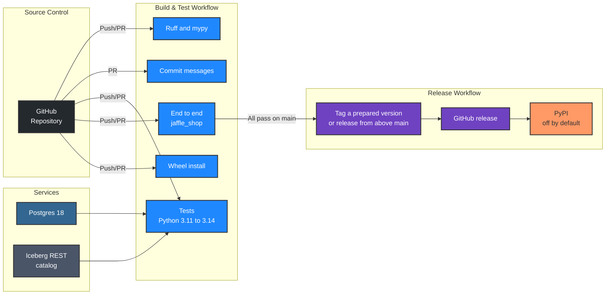

# Development

## Prerequisites

- [uv](https://docs.astral.sh/uv/) (it installs Python 3.12 for the project)
- Docker, for the Postgres and Iceberg integration tests
- Node.js 24 (see `.nvmrc`) and [pnpm](https://pnpm.io/), only to work on the graph viewer
- [vhs](https://github.com/charmbracelet/vhs), only to re-record the demo GIFs

## Installation

1. **Clone the repository**
   ```bash
   git clone git@github.com:kodexlabsio/konstruct.git
   cd konstruct
   ```

2. **Install dependencies and the git hooks**
   ```bash
   uv sync
   uv run pre-commit install
   ```
   The hooks run Ruff and mypy before each commit (and the viewer checks when `viewer/` changed), check the commit message, and run the tests before each push.

## Tests

```bash
uv run playwright install chromium              # once, for the browser tests
uv run pytest                                   # Postgres and Iceberg REST tests skip without services
eval "$(.kodex/scripts/services.sh up)"         # start them in Docker and export their addresses
uv run pytest --cov                             # everything, with branch coverage (fails under 90%)
.kodex/scripts/services.sh down
```

| Kind | Where | What it checks |
|------|-------|----------------|
| Unit | `test_graph`, `test_sql`, `test_dbt`, `test_airflow`, `test_report`, `test_skill`, ... | Each module, including lineage through CTEs, joins, aliases, `SELECT *`, unions and window functions |
| Property-based | `test_properties` | Invariants on generated inputs with Hypothesis: impact and trace are inverse, lineage matches generated CTE chains in seven dialects, Airflow dependencies match generated DAGs, no text crashes the SQL analysis |
| Integration | `test_warehouse`, `test_build`, `test_cloud_warehouses` | DuckDB, Postgres and Iceberg (SQL and REST catalogs) for real; Snowflake against fakesnow and BigQuery against its emulator; Databricks against a stub; builds of projects with and without dbt |
| End to end | `test_build`, `test_cli`, `test_query`, `test_mcp` | The example built with real dbt, every CLI command, the Python API, and the MCP server in process and over stdio |
| Golden files | `test_golden`, `tests/golden/` | The exact text of the CLI output and REPORT.md; regenerate with `KONSTRUCT_UPDATE_GOLDEN=1` and review the diff |
| Browser | `test_browser` | graph.html in Chromium: selection, column rows and edges, formulas, deep links, isolate, direction, filters, themes, search, hostile text, a 400-relation graph |
| Usage | `test_usage` | The SQL sent to Snowflake, BigQuery and Databricks, query text parsing for BigQuery, usage on columns, in the report and describe, the daily cache, off by default, and missing permissions as a warning, against stub drivers in each vendor's row shapes |
| Conflicts | `test_conflicts` | Two revenue definitions that differ by one filter (the pair, the filter and its file), different sources, ranking, grouping by business terms, copies left out, no false conflicts on the example |
| Ontology | `test_ontology` | Entity names and keys from unique tests, primary keys, identifier fields and grains; terms that name entities; measures and their formulas; relationships, cardinality and `tested`; every rule; the same output whatever the graph's order; the build file, the CLI and the example project |
| Ossie | `test_ossie` | Both Ossie shapes, the build input and its warnings, composite keys and relationships, data types, and an export validated against the Ossie schema, including a metric read from Ossie and written back |
| Looker | `test_looker` | LookML views: tables (or the view's own name), the columns each field reads (through other fields, dimension group timeframes and the default ones, own-view references, location and duration SQL, measure filters, cycles), refinements, `extends` (added to by refinements, with a child's own table winning) and abstract views, derived tables, Liquid table names and unknown columns as warnings, column impact reaching only the views that read the column, tables only Looker names, and `[looker] paths` |
| Power BI | `test_powerbi` | TMDL tables, descriptions, columns, measures (one line, several lines, with properties and annotations after them), calculated columns, tabs or spaces, CRLF and a byte order mark; warehouse tables from `Schema`/`Item` and `Name`/`Kind` navigation (fenced M, BigQuery, merged tables), shared expressions, native queries in the connector's dialect (server names in brackets, `#(lf)`, `[Query=...]`), Direct Lake entities and incremental refresh; DAX references across tables, measures on measures (a chain of 400 resolved in time), `VAR` names, calculated columns and comments and strings left out; automatic date tables left out; partitions with no table, native queries reading none, duplicate tables and models as warnings; exposures fed column by column with the fields that read each column; impact reaching only them; unknown columns as warnings; tables only read elsewhere growing the columns named; `--update`; `[powerbi] paths`; `konstruct status` and `init` |
| Definitions | `test_definitions` | The definitions.yml format and its errors, terms in the build, `define`, describe, search, query and impact, the glossary, warnings for missing columns and filters (including a renamed bound column in the example), and `diff` on definitions |
| Formulas | `test_explain` | `explain` on dbt and Airflow SQL, and composed formulas evaluated on the data against the final model, row for row; the viewer's formula cache |
| Export | `test_export` | OpenLineage events validated against the OpenLineage JSON schemas; Mermaid, DOT and CSV |
| Scale | `test_scale` | A generated 300-model project: full build and `--update` times |
| Real world | `test_realworld` | dbt Labs' jaffle-shop at a pinned commit (needs network; `KONSTRUCT_REALWORLD=1`) |
| Lineage against data | `test_verify` | `verify` confirms true lineage and catches removed edges, false edges and dropped filters; a differential property test runs generated queries on generated data and requires the static lineage to agree with execution |
| Gate | `test_gate` | `gate` on real git repositories: a safe change passes; a breaking change, a new meaning for an approved term and a new conflicting column fail, each with its file and fix; a conflict the change does not touch does not; the CLI's exit status, JSON and markdown |
| Change review | `test_diff` | `diff` on real git repositories: formatting and CTE renames are not changes, removed columns still read downstream are breaking, conditions, DAGs, two commits, all output formats, and dbt Jinja rendering |
| PySpark | `test_spark` | The SQL a job passes to `spark.sql` (literals, f-strings without placeholders, concatenations, names bound once), names bound more than once and SQL formatted with keyword arguments as warnings, which files are jobs (Databricks notebooks too) and which objects are sessions (Snowpark files apart), `spark_catalog` left out, column lineage of the tables a job writes, `[spark] paths` and `dialect`, `konstruct status` and `init` |
| Dagster | `test_dagster` | The Dagster parser, assets and op jobs joining dbt and warehouse lineage, sensors ordering work, and parity with Dagster's own asset and job graphs (needs Dagster; see the CI job) |
| Databricks | `test_databricks_live` | The connector against a Databricks workspace with Unity Catalog; runs when workspace credentials are set (see the file) |
| Fivetran and Airbyte | `test_loaders` | Which tool landed a table (Fivetran, Airbyte Destinations V2 and V1), a sync task per schema, Airbyte raw tables feeding their namespace, the Platform Connector lineage read from a DuckDB warehouse (source tables and columns, column lineage into landed tables, deleted source tables and other destinations left out, even one landing a schema of the same name), short names still meaning the landed table, complete formulas and unchanged coverage, an unclear destination as a warning, names that need quoting, the query for the older `connector` schema, for Snowflake and for BigQuery, an unreadable lineage schema as a warning, and `[fivetran] lineage` |
| Trino | `test_trino` | The connector against a stub of the client (comments from `system.metadata`, `row` fields, views, servers without column comments, password and JWT authentication, `konstruct.toml` and dbt profiles, samples keeping Trino's types) and, in the Trino job, against a Trino server's memory catalogue (`KONSTRUCT_TEST_TRINO_HOST`) |
| Agent benchmark | `test_agent_benchmark` | The harness on a miniature Spider 2.0-DBT tree with a scripted agent: both arms, the same prompt, the graph and skill only in the Konstruct arm, the database the profile writes, scoring, timeouts that stop what the agent started, refusing an output directory with instructions above it, and resuming |
| Survey | `test_survey` | The public-project survey on local git repositories: a dbt project built through a generated DuckDB profile with file and network access off, one that is not dbt and one that does not clone, a project that cannot write outside its database or read the surveyor's environment, pinning by commit, the timeout, `env_var` profile names, the aggregate summary naming no project, and resuming |
| Parity | `test_airflow_parity` | The static Airflow parser against Airflow's own DagBag (needs Airflow; see the file for the command) |

The dev dependencies include dbt-core and dbt-duckdb, so the dbt and end-to-end tests build a copy of the example project for real. In CI, `KONSTRUCT_REQUIRE_SERVICES=1` turns a missing service or browser into a failure rather than a skip, and `HYPOTHESIS_PROFILE=ci` runs more generated examples.

## The Graph Viewer

graph.html is a Svelte 5 and TypeScript app in `viewer/`, built with Vite into one self-contained file, `konstruct/viewer.html`, with its script, styles and fonts inlined (the font licences are in `licenses/`). That file is committed, so installing Konstruct needs no Node.js; Konstruct fills its two data placeholders when it writes graph.html.

```bash
cd viewer
pnpm install
mkdir -p dev && cp ../examples/jaffle_shop/konstruct-out/graph.json dev/   # data for the dev server
pnpm dev                     # http://localhost:5173/viewer.html, reloading as you edit
pnpm check                   # svelte-check (strict TypeScript)
pnpm test                    # Vitest: layout, focus, search and the graph model
pnpm build                   # writes ../konstruct/viewer.html; commit it with the source
```

Pre-commit hooks check formatting and types and rebuild the page when `viewer/` changes, and a CI job fails if the committed build does not match the source. The browser tests (`tests/test_browser.py`) drive the built page in Chromium and fail on any network request.

## Other Commands

- `uv run ruff check`, `uv run ruff format`, `uv run mypy`: lint, format and type check (strict)
- `uv run .kodex/scripts/prepare_example.py`: build the example warehouse
- `vhs .kodex/scripts/demo-cli.tape`: re-record `docs/images/demo-cli.gif`
- `.kodex/scripts/demo_diff_setup.sh && vhs .kodex/scripts/demo-diff.tape`: re-record `docs/images/demo-diff.gif`
- `vhs .kodex/scripts/demo-claude-code.tape`: record the same question through `/konstruct` in Claude Code (needs Claude Code signed in)

## Agent Benchmark

`.kodex/scripts/agent_benchmark.py` runs a coding agent on [Spider 2.0-DBT](https://github.com/xlang-ai/Spider2/tree/main/spider2-dbt), dbt projects on DuckDB each with an instruction and a gold database, in two arms: the project as shipped, and the same project after `konstruct build` and `konstruct install --target .`. Both arms get the same prompt, which carries the benchmark's own hints and does not mention Konstruct. As in the benchmark's protocol, the agent runs `dbt run` itself, and the database the project's dbt profile writes is scored as the agent leaves it, with the benchmark's own `duckdb_match`.

```bash
uv run .kodex/scripts/agent_benchmark.py ~/Spider2/spider2-dbt --agent 'claude -p {prompt} --permission-mode acceptEdits'
```

`{prompt}` in the agent command is replaced by the prompt, quoted. Prepare the benchmark first as its README says (download its databases, run its `setup.py`). Each project copy is its own git repository, and `--out` (by default a new temporary directory) must not be inside a git repository or under a `CLAUDE.md`, `CLAUDE.local.md`, `.claude` or `AGENTS.md`, so the agent reads no instructions from above the project. `--only` runs some instances, `--arms` one arm, `--mcp` also registers the MCP server (pass it to the agent too, such as `--mcp-config .mcp.json`; the baseline copy gets an empty `.mcp.json`, so the same command works in both arms), `--dbt-run` runs `dbt run` once more before scoring, and `--timeout` stops an agent and everything it started; whatever an agent leaves running is stopped before scoring. Each run writes the projects with their logs beside them, `results.jsonl` and `summary.md`; a run that stops resumes with the same options.

## Public Project Survey

`.kodex/scripts/survey.py` builds a list of public dbt projects and reports, in aggregate only, what Konstruct finds in them: models, the share of columns with column lineage, conflicting definitions and their kinds, the size of the ontology, warnings by kind and build time. The list is a text file with one git URL per line, optionally followed by a commit, tag or branch.

```bash
uv run .kodex/scripts/survey.py projects.txt --out survey --deps
```

Each project is cloned and built without its warehouse: the script writes a DuckDB profile under each profile name the project uses, so dbt can produce the manifest. That runs dbt on the project, which renders its Jinja and runs the queries its macros issue, against an empty DuckDB database with file and network access turned off, with a home directory of its own and none of your environment variables but those needed to run and to reach a proxy. `--deps` runs `dbt deps` first, which downloads the packages the project names, so package macros render. Run it in a disposable container with no credentials in its environment. Each project is surveyed in a child process, stopped after `--timeout` seconds (900 by default) and recorded as timed out. The script writes `projects.jsonl`, one line per project, and `summary.md`, which names no project; a run that stops resumes where it left off.

## Commits

Commits follow [Conventional Commits](https://www.conventionalcommits.org/), checked by commitizen and by `.kodex/scripts/check_commit_message.py`, which applies the Kodex Labs rules: a fixed list of scopes, sentence-case subjects, lines of at most 100 characters, no AI attribution lines, and no business or fundraising terms. The scopes are `airflow`, `dagster`, `dbt`, `definitions`, `iceberg`, `sql`, `warehouse`, `build`, `graph`, `html`, `lineage`, `query`, `report`, `cli`, `mcp`, `skill`, `examples`, `readme`, `tests`, `ci`, `config`, `deps`, `deps-dev` and `release`.

## Repository Layout

| Path | Contents |
|------|----------|
| `konstruct/graph.py` | Graph model, name resolution, impact, trace and path |
| `konstruct/sql.py` | sqlglot column lineage, canonical expressions and conditions |
| `konstruct/dbt.py`, `jinja.py`, `airflow.py`, `dagster.py`, `spark.py`, `looker.py`, `powerbi.py`, `loaders.py`, `warehouse.py`, `definitions.py` | Inputs, the sandboxed dbt renderer and business definitions |
| `konstruct/ontology.py`, `ossie.py` | The ontology derived from the graph, and Apache Ossie models read and written |
| `konstruct/config.py`, `build.py`, `usage.py` | Configuration, discovery, the build and its cache, and usage from query history |
| `konstruct/query.py`, `explain.py`, `conflicts.py`, `diff.py`, `gate.py`, `verify.py` | Questions over the graph: impact and the rest, formulas, conflicting definitions, change review, the gate, lineage against data |
| `konstruct/report.py`, `html.py`, `export.py` | REPORT.md, writing graph.html, and the export formats |
| `konstruct/viewer.html` | The built graph viewer (generated by `pnpm build`; do not edit) |
| `viewer/` | The graph viewer's source: Svelte 5 and TypeScript, built with Vite |
| `konstruct/project.py` | The Python API |
| `konstruct/cli.py`, `console.py`, `status.py`, `mcp_server.py`, `skill.py` | Interfaces |
| `action.yml` | The GitHub Action |
| `examples/jaffle_shop` | dbt Labs' jaffle_shop_duckdb (Apache-2.0, see its NOTICE) with an Airflow DAG |
| `.kodex/scripts` | Project scripts: example preparation, test services, commit rules, benchmarks, demo tapes |

## CI/CD

Build and Test runs on every push to `main` and on pull requests: Ruff and mypy, a commit message check on pull requests, the test suite on Python 3.11, 3.12, 3.13 and 3.14 against Postgres and Iceberg REST catalog service containers, an end-to-end build of the jaffle_shop example that fails if it takes a minute or more, an install of the built wheel with `uv tool install`, an install from GitHub exactly as this README describes, the real-world jaffle-shop test, the Airflow parity test, and the Trino connector against a Trino server. The test job also runs the browser tests in Chromium and fails below 90% branch coverage. main is protected, and nothing pushes to it: a release is a tag and a GitHub release. Changes accumulate on a branch and merge in batches, about once an hour, by rebase, so each commit stays on `main`. The batch's last commit prepares the release with `uv run python .kodex/scripts/prepare_release.py`, which reads every releasable commit on the branch since the last tag and sets the next version in `pyproject.toml`, `uv.lock` and `konstruct/__init__.py`, with its section at the top of `CHANGELOG.md`. While the version is 0.x a release is a patch, or the next minor for a breaking change; the script and the workflow both refuse 1.0. The Release preparation job checks on every pull request that a prepared release still matches `main`. Create Release runs after Build and Test passes on a push to `main`: it tags a tested commit whose version has no tag; otherwise, when `main` has releasable commits since the last tag (a Dependabot fix, say), it writes the next version on a commit above `main` and tags that. It pushes only tags, after the build succeeds, finishes a release left half done, moves the `v0` tag (or re-points it when it lags), and publishes a GitHub release with the changelog section, wheel and sdist. Run by hand from the Actions tab, it only finishes or tags a prepared version. Publishing to PyPI is a separate job that stays off until the `PUBLISH_TO_PYPI` repository variable is `true` and a `pypi` environment with trusted publishing exists.

Every action in the workflows and in `action.yml` is pinned to a full commit SHA, with its version in a comment, and the service containers to image digests, so a run is reproducible and a moved tag cannot change what CI executes. Dependabot moves the action SHAs; the image digests, which carry the tag they track, are updated by hand. OpenSSF Scorecard runs weekly and on every push to `main`, and publishes its results to the repository's Security tab.


