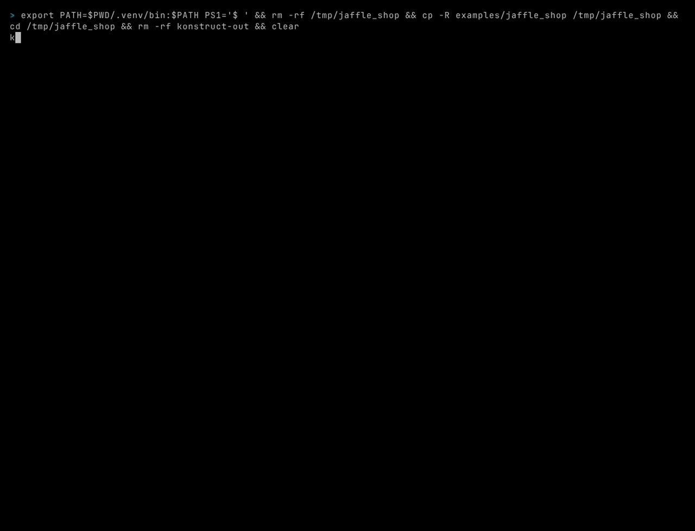

# Getting Started

Konstruct is not on PyPI yet, so install it from GitHub with [uv](https://docs.astral.sh/uv/):

```bash
uv tool install git+https://github.com/kodexlabsio/konstruct
```

Konstruct is Python with a compiled core in Rust, so installing from GitHub builds that core and
needs a [Rust toolchain](https://rustup.rs/) (1.88 or newer) on the machine: `curl --proto
'=https' --tlsv1.2 -sSf https://sh.rustup.rs | sh` installs one. GitHub's hosted runners have one
already. To install without Rust, use a release's wheel (below). Konstruct runs on x86_64,
aarch64 (arm64), riscv64, ppc64le, s390x and loongarch64 processors, on Python 3.11 or newer.

Or run it without installing anything, each time:

```bash
uvx --from git+https://github.com/kodexlabsio/konstruct konstruct build
```

For a warehouse extra, name it in the requirement, for example
`uv tool install "konstruct[snowflake] @ git+https://github.com/kodexlabsio/konstruct"` (or `[bigquery]`, `[databricks]`, `[trino]`, `[rdf]` for SKOS and OWL vocabularies, `[all]`).
To pin a release, add its tag: `git+https://github.com/kodexlabsio/konstruct@v0.8.0`. Each [release](https://github.com/kodexlabsio/konstruct/releases) also has wheels attached, which need no Rust toolchain: for Linux on x86_64, aarch64, ppc64le, s390x, riscv64 and loongarch64 (glibc 2.28 or newer, 2.31 for riscv64 and 2.36 for loongarch64), for macOS on Apple silicon and Intel, and for Windows on x64 and arm64. Install one with `uv tool install <wheel URL or file>`. Each file attached, the sdist and the CycloneDX SBOM of the locked dependencies too, has a signed build provenance attestation; `gh attestation verify <file> -R kodexlabsio/konstruct` checks a downloaded file.

Then, in a repository with dbt models, SQL, DAGs or a warehouse:

```bash
cd your-data-repo
konstruct status                 # what konstruct finds here, before building anything
konstruct build                  # writes konstruct-out/: graph.json, REPORT.md, graph.html, ontology.yml
konstruct impact orders.amount   # everything downstream of a column
konstruct open                   # the interactive graph in a browser
konstruct install                # adds the /konstruct skill to Claude Code and Cursor
```



To try it on the bundled example (jaffle_shop on DuckDB, with an Airflow DAG), from a clone of this repository:

```bash
uv sync
uv run .kodex/scripts/prepare_example.py      # builds the example's DuckDB warehouse with dbt
uv run konstruct build examples/jaffle_shop    # about a second
uv run konstruct impact stg_payments.amount -C examples/jaffle_shop
```

`konstruct build` needs no configuration: it finds dbt projects, Airflow DAG files, Dagster definitions, PySpark jobs, LookML, Power BI semantic models, SQL files, DuckDB files and the warehouse each dbt profile points at (DuckDB, Postgres, Snowflake, BigQuery, Databricks or Trino), and prints what it found and what it did with each. If a dbt project's `target/manifest.json` is missing or older than the project files and `dbt` is on `PATH`, it runs `dbt docs generate` first. `konstruct init` writes a commented `konstruct.toml` recording what discovery found, for when you want to pin or change it.

```text
$ konstruct build
konstruct  /src/jaffle_shop

  dbt        jaffle_shop (.)  5 models, 3 seeds, 20 tests, 1 exposure  (artefacts up to date)
  duckdb     duckdb jaffle_shop.duckdb  9 relations  (dbt profile jaffle_shop)
  airflow    dags/jaffle_shop_daily.py  1 DAG, 6 tasks

  graph      1 dag, 1 exposure, 5 models, 3 seeds, 1 table, 6 tasks, 20 tests; 44 columns
  lineage    32 of 32 columns of models and built tables (100%)
  warnings   none
  wrote      graph.json, REPORT.md, graph.html, ontology.yml to konstruct-out in 0.7s
```
