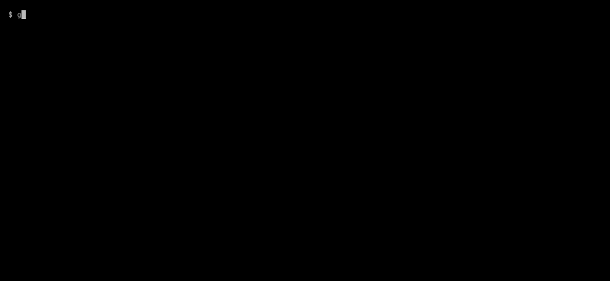

# Reviewing Changes

`konstruct diff` answers "what does this branch do to the data?" For each dbt model, SQL file and DAG file that changed, it analyses the base and current versions and compares each output column's canonical expression: the expression with every CTE, subquery and alias inlined down to physical columns. Reformatting, renaming a CTE or reordering columns is therefore not a change, and a real change is shown in full. Join, filter and grouping conditions are compared the same way. A removed column is breaking when a downstream model's current SQL still reads it, so a change that also updates its consumers is not flagged.

A relation's conditions are the clauses that decide which rows it has. Each names its columns, and the tables a subquery in it reads, by their relations, without aliases, so renaming an alias is no change. Each is listed with a label that says where it applies, so moving it to where it decides other rows is a change:

| Label | Where the condition applies |
|-------|-----------------------------|
| `WHERE`, `JOIN ON`, `GROUP BY`, `HAVING`, `QUALIFY` | The rows of the query, wherever in its CTEs and subqueries it is written. A join is labelled with its kind, as written (`INNER JOIN ON`, `SEMI JOIN ON`). `GROUP BY ALL` is listed as the keys it groups by: the select items without an aggregate, a window function or a function sqlglot does not know, which may aggregate |
| `LEFT JOIN ON`, `RIGHT JOIN ON`, `FULL JOIN ON` | Which rows an outer join joins. A CTE or subquery that the join reads and that only selects and filters has its `WHERE` here, as the same condition in the `ON` would |
| `LEFT JOIN WHERE`, `RIGHT JOIN WHERE`, `FULL JOIN WHERE` | Any other filter on the side of an outer join that may find no row: it decides which rows join, where the same filter outside the join removes rows |
| `DISTINCT`, `DISTINCT ON` | The rows a `SELECT DISTINCT` keeps, by the columns it selects, or the one row for each key a `DISTINCT ON` keeps |
| `LIMIT`, `OFFSET`, `ORDER BY` | How many rows a query keeps or skips, and the order it picks them in. An `ORDER BY` is listed only where a `LIMIT`, an `OFFSET` or a `DISTINCT ON` picks rows by it |
| `UNION`, `INTERSECT`, `EXCEPT` | A set operation that removes duplicates or matches rows, as `UNION: DISTINCT` or `INTERSECT: ALL`. A `UNION ALL` keeps every row of each branch and has no label |
| `ROWS FROM` | The rows a query makes itself, from a table function such as `range(2)`, a `VALUES` list, an `UNNEST`, a `LATERAL`, a `LATERAL VIEW` or a Snowflake `TABLE(...)`, which no column of a relation describes |
| `... BEFORE WINDOW`, `... BEFORE LIMIT` | A condition applied before a window function or `QUALIFY`, or before a `LIMIT` or `OFFSET`, which see the rows it leaves; the steps are listed nearest first, as `WHERE BEFORE WINDOW, LIMIT` |

In an [OpenLineage export](exporting.md), a filter of the side of a `LEFT JOIN` that is listed under the join's `LEFT JOIN ON` has the subtype `JOIN`; one listed as a `LEFT JOIN WHERE` keeps the subtype `FILTER`.

The base is the merge base with main unless `--base` names another commit or a date: `konstruct diff --base 2026-10-01 --head HEAD` shows what changed in the data stack since the first of October, column by column, taking the last commit on the current branch before that date begins. A date and time (`2026-10-01 14:30`) is also accepted; both are read in the machine's local time zone, and a branch or tag named like a date is taken as that ref. JSON output keeps the date as `base` and gives the commit it stands for as `base_commit`.



```text
$ konstruct diff
Diff main..working tree (4 files changed)
1 breaking change, 1 column changed, 1 column removed, 1 column added, row logic changed in 1
relation, 1 DAG changed, 1 exposure affected.

models/orders.sql  (model orders, modified)
  rows     + WHERE jaffle_shop.main.stg_orders.status <> 'returned'
           affects 10 tests, 1 exposure and 1 task downstream (exposures: customer_dashboard)

models/staging/stg_payments.sql  (model stg_payments, modified)
  added    method
  changed  amount
             was  jaffle_shop.main.raw_payments.amount / 100
             now  jaffle_shop.main.raw_payments.amount / 100.0 * 1.2
           affects 7 columns, 3 relations, 5 tests, 1 exposure and 2 tasks downstream (exposures:
           customer_dashboard)
  removed  payment_method
           BREAKS orders, which still reads it
           affects 4 columns, 1 relation, 5 tests, 1 exposure and 1 task downstream (exposures:
           customer_dashboard)

dags/jaffle_shop_daily.py  (DAG jaffle_shop_daily, modified)
  runs     task `dbt_run_marts`: no longer runs orders
```

`diff` also works out what dbt has to rebuild: the changed models, the models whose columns, joins or filters are downstream of a changed column, and the tests on them. It prints that as a `dbt build --select` command (or just the selection, with `--format selector`) and compares it with what `state:modified+` would build: on the example above it builds 3 of the 4 models, because the reformatted `stg_customers` needs nothing. A test builds the project with dbt before and after a change and checks that every model whose data changed is in the selection. It also reads dbt YAML, reporting tests, sources and exposures added or removed and descriptions changed.

dbt models are compared by rendering their Jinja without dbt (see How Lineage Works), so `diff` needs no warehouse and no credentials. `--json-file` writes the result as JSON beside any format, including the list of breaking changes, for scripts.

## When a Formula Changed

`konstruct history <table.column>` answers "when did this number's calculation change, and who approved it?" It reads the git history of the file that defines the column (a dbt model, a SQL file, or the SQL file a DAG task runs), following renames, and works out the column's formula at each commit and at its parent with the same analysis as the build, so a commit that only reformats the SQL, or a merge, is not listed. It also reads the history of every `definitions.yml` that binds a business term to the column, and lists each change to the term's status, approval date, owner and definition with the commit's author and date. Uncommitted edits come last.

```text
$ konstruct history ltv.total
History of ltv.total (ltv.sql)
2 formula changes; 'lifetime value' last approved by Grace in 745d991, before the latest formula
change.

  2026-01-05  c9e560a  Ada  Add lifetime value
    added  SUM(orders.amount)
    term  'lifetime value'  definition  none → What a customer has paid us.
                            owner       none → Ada
                            status      none → draft

  2026-02-01  745d991  Grace  Approve lifetime value
    term  'lifetime value'  owner   Ada → Grace
                            status  draft → approved

  2026-04-01  d71c2ce  Linus  Net of refunds
    was  SUM(orders.amount)
    now  SUM(orders.amount - orders.refund)
```

The summary says whether a bound term was approved after the latest formula change, so a formula that changed after its approval stands out. Commits are ordered by ancestry, not by date, so a change rebased onto a branch after an approval comes after it. A term is approved by a commit that makes its status `approved`, or that moves its `approved` date while it stays approved; a term that first appears already approved, such as a renamed one, is not an approval. Where the history is incomplete (a shallow clone, or more commits than `--limit`, default 50), or a version's SQL cannot be analysed, a note says so. `--json` gives the same result for scripts and agents, which can also ask through the `history` MCP tool.

## Pinning What You Read

A repository that reads another team's data, a dashboard repository, a downstream dbt project or a feature pipeline, pins exactly what it relies on with `konstruct lock`. For each upstream column the project reads (one it does not build: from a repository listed in `repositories`, or a table in a shared warehouse), `konstruct.lock` records a fingerprint of the column's formula composed down to source columns, the row conditions of every relation on the way (with the labels above, including those of the relations it is joined to, filtered or grouped by), the source columns it reaches, its type, the business terms bound to it with a version of their meaning, and its verification state. Commit the file. Names limit the lock to those columns, relations, exposures or terms: `konstruct lock weekly_dashboard` pins what that exposure reads.

`konstruct lock --check` fails with exit status 1 when a pinned column's formula, row conditions, sources or type, or an approved term bound to it, is not what was locked, or when the column is no longer built. Run it in the consumer's CI. Each change shows the locked and current formula side by side, who changed it from git history, which of the project's own columns read it, and the command to accept it, or the commit to revert to keep the locked meaning:

```text
$ konstruct lock --check
konstruct.lock: 1 of 2 pinned upstream columns changed since it was locked.

main.ltv.total  (ltv.total, built by finance, ../finance/ltv.sql)
  formula changed
    locked  SUM(orders.amount)
    now     SUM(orders.amount) * 2
    change  added * 2
  changed by         Ana in 327233e on 2026-11-11: Double lifetime value
                     ltv.total: was SUM(orders.amount)
                                now SUM(orders.amount) * 2
  your columns       report.doubled
  accept it          konstruct lock --update main.ltv.total
  or keep the old    ask finance to revert 327233e (by Ana)
```

Fingerprints are built from canonical expressions, so reformatting, renamed CTEs, reordered columns, passthrough models, a mirrored comparison (`10 <= a` is `a >= 10`), conjuncts in another order and a filter moved into a model upstream are not changes. A relation reached through the side of an outer join that may find no row, or before a window function or `LIMIT`, is pinned as such (`LEFT JOIN main.customers BEFORE WINDOW`), so moving a filter across the join or the window is a change; the lockfile writes a `RIGHT JOIN` as the `LEFT JOIN` of its sides the other way round, and drops `OUTER` and `INNER`. A seed is pinned by a checksum of its file, and a column with no formula (a Python model) by a checksum of the file that builds it.

A pinned column keeps its pin, as a package lockfile keeps its versions: `konstruct lock` adds what the project newly reads and drops what it no longer does, brings up to date what fails no check (an approval date, a verification), and keeps the rest as locked. `konstruct lock --update` accepts every change after review, and `konstruct lock --update main.ltv.total` the change to one column. The file records the canonical form it was printed in; a Konstruct that prints formulas differently fails the check once, asking to re-lock after review, rather than pin by pin. `--format markdown` gives the check for a pull request comment, naming no commit or author, and `--json` the result for scripts; the `lock_check` MCP tool gives the same to an agent.

A producer that lists its consumers in `repositories` learns what a change does to them before they do: `konstruct gate` fails with `consumer-pin-changed` when the change alters a column a consumer pins in its `konstruct.lock`, naming the consumer, what changed and the command the consumer runs to accept it. Only the pins on columns the change alters are checked, so a consumer that has not re-locked since an earlier change does not fail every change after it; a consumer lockfile that cannot be read fails only a change to a column that repository reads.
