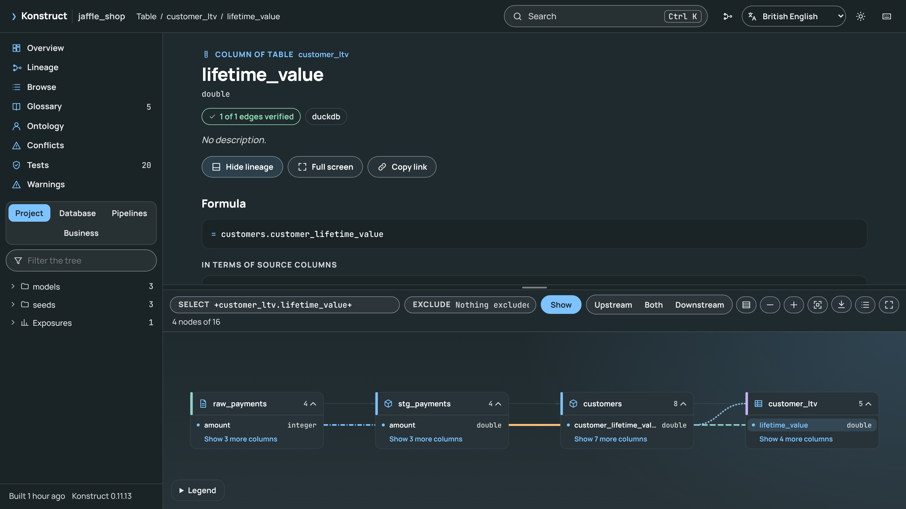
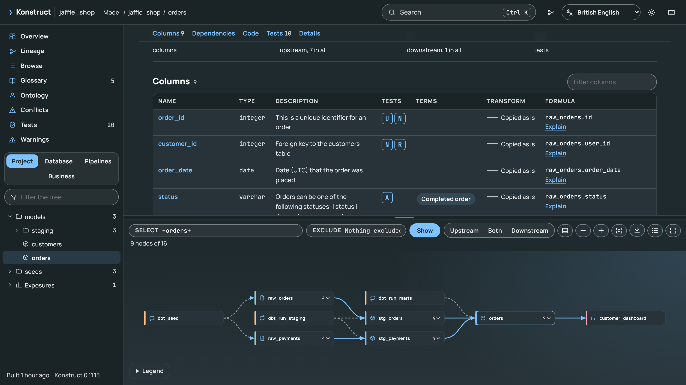
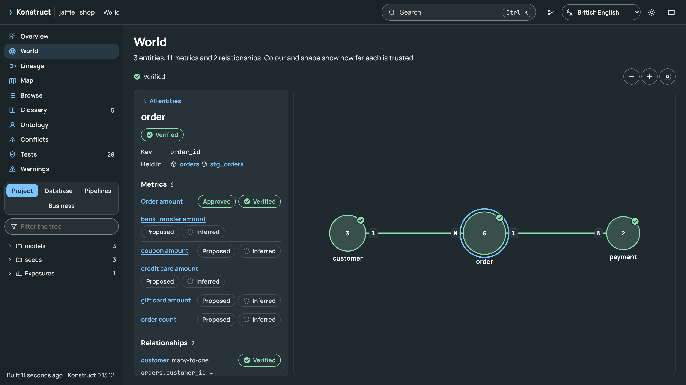
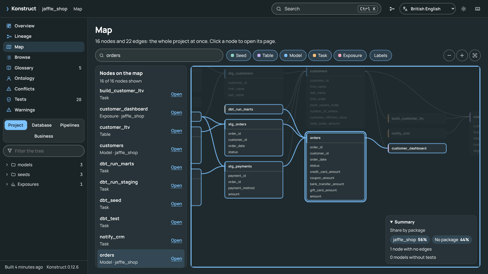

# The Graph Viewer

Every build writes `konstruct-out/graph.html`: one offline file that opens in any browser (`konstruct open`), from disk or served over HTTPS. It loads nothing from the network, so it can be attached to a ticket, published as a build artefact or opened on a laptop with no connection. It carries a strict Content-Security-Policy: its script and styles are allowed by hash, with no inline event handlers, no `eval` and no other origins, so it can be hosted where such a policy is required. The [live demo](https://kodexlabsio.github.io/konstruct/demo/) is the viewer for the jaffle_shop example, built with each version of these pages.

The viewer is a documentation site for the data stack, built from the graph: a page for every model, source, seed, snapshot, table, column, task, DAG, test, exposure, business term and entity, a lineage graph that takes dbt's selectors and goes down to columns, and search across all of it.

## The Layout

- **The top bar** has the project name, where you are, search (`Ctrl K`), the full lineage graph, the language, the theme and the keyboard shortcuts.
- **The navigation** on the left lists the pages (overview, world, lineage, map, browse, glossary, ontology, conflicts, tests, usage and warnings) and four trees: the **project** by dbt package and folder with sources and exposures, the **database** by schema, the **pipelines** by DAG and task, and the **business** vocabulary of terms and entities. Type in the filter box to narrow a tree.
- **The page** in the middle describes what you opened.
- **The lineage graph** is docked beneath pages about one thing, showing its lineage; drag the bar between them to resize it, press `L` to hide it, or open it full screen.

Every page and view has its own address, such as `graph.html#/node/model.shop.orders`, `graph.html#/lineage?select=+orders+` or `graph.html#/browse?kind=model&tag=nightly`, so links can be shared and the browser's back and forward buttons work. Links written by earlier versions (`graph.html#model.shop.orders%23amount`) still open their node.

## Pages

- **World**: the business's entities, relationships and metrics as a map, each marked with how far it is trusted (see [The World Map](#the-world-map)).
- **Overview**: counts of models, sources, seeds, tables, tasks, tests, terms and columns; coverage of column lineage, verification on data, descriptions and tests; conflicting definitions, build warnings grouped by input, the inputs the build read, and what most depends on.
- **Models, sources, seeds, snapshots and tables**: description, warehouse name, materialisation, package, tags, entities, origins and verification; the columns with their type, description, tests (`U` unique, `N` not null, `A` accepted values, `R` relationships), business terms, the kind of transform and the formula in terms of source columns, each linked to the column's explanation; what it depends on and what references it; the joins and filters that shape its rows; the SQL as written and as dbt compiled it; its tests, column usage and details; and commands to ask Konstruct next.
- **Columns**: the formula with CTEs and aliases inlined and the same formula in terms of source columns (see [Explaining a Column](explain.md)), every step upstream and downstream with its transform, formula and verification, the relations that join, filter or group on it, its tests and the terms that define it.
- **Business terms**: the definition, status, owner, grain, unit, synonyms and required filters, the bound columns with their formulas and verification, conflicts, and broader, narrower and related terms (see [Business Definitions](definitions.md)). The **glossary** lists every term from A to Z.
- **Ontology and entities**: entities with their keys and the relations that hold them, measures with their formulas, relationships with cardinality, each with its trust, and the ontology's rules (see [The Ontology](ontology.md)).
- **DAGs and tasks**: schedule, tasks in run order, what each runs, its command or SQL, and what runs before and after it.
- **Browse**: every table, model, task and exposure in a sortable table, filtered by kind, package, tag and text.
- **Conflicts**: columns that compute the same idea differently, side by side, with what differs, as `konstruct conflicts` last found them in the same graph (see [Conflicting Definitions](conflicts.md)).
- **Tests**, **usage** (see [Column Usage](usage.md)) and **warnings**.

Descriptions are Markdown, as in dbt's documentation: paragraphs, lists, tables, code, emphasis and links to web and mail addresses. The overview opens with the dbt project's `` block when it has one.

The SQL comes from the project's files when the page is written; a page written away from the project shows each column's expression instead. Compiled SQL is dbt's own, so it holds whatever dbt rendered into it, `env_var()` values included: keep secrets out of model SQL before sharing a page.

## The Lineage Graph

The **Select** box takes dbt's node selection syntax, and **Exclude** removes nodes from it:

| Selector | Shows |
|----------|-------|
| `orders` | The model `orders` |
| `+orders`, `orders+`, `+orders+` | It and everything upstream, downstream, or both |
| `2+orders+1` | Two levels upstream and one downstream |
| `@orders` | Its descendants and all of their ancestors |
| `tag:nightly`, `path:models/marts`, `package:shop`, `kind:source`, `materialized:view` | Nodes by property; `*` matches any text |
| `source:raw.orders`, `exposure:dashboard`, `dag:nightly` | Sources, exposures and the tasks of a DAG |
| `term:"Order amount"`, `entity:customer` | The columns a business term binds, the relations that hold an entity |
| `orders.amount`, `+orders.amount+` | A column and its column-level lineage |
| `tag:nightly,kind:model` | Commas intersect; spaces unite |

- **Layout.** Nodes are laid out in layers from sources on the left to dashboards on the right, with crossings reduced. Very wide layers wrap into several columns, so graphs of thousands of nodes stay readable; only the cards near the window are drawn, and far out the cards show their names alone.
- **Highlighting.** The node a page is about, or the one you click, lights its impact path and dims the rest. **Upstream**, **Both** and **Downstream** rewrite the selection around it.
- **Expanding and collapsing.** A highlighted card shows `+` handles for neighbours outside the selection; a card's count opens its columns, and **Columns** opens every card. Clicking a column shows its path.
- **Edges by transform.** Column edges say what a step does: copied as is, renamed, cast, calculated, aggregated, a window function, or a join or filter. Each has its own colour and line pattern, explained in the legend, where each can be hidden; relation edges show data flow and, dashed, what a task runs.
- **Verification.** After `konstruct verify`, confirmed edges are marked and pages show how many edges were checked (see [How Much to Trust the Lineage](verify.md)).
- **Minimap, list and export.** A minimap shows where you are in a large graph; **List** shows the graph as text; **Export** saves the current view as SVG or PNG.

With **Columns** on, the graph is a column-level map of the selection:

## The World Map

The **World** page draws the ontology as a map of the business: each entity is a circle, sized by how many metrics it has and numbered with them, and each relationship is a line labelled at its ends with its cardinality, `N` at the many end and `1` at the one end. It is drawn as SVG, so it needs no WebGPU, and the layout is the same each time for the same ontology.

- **Trust.** Every entity, relationship and metric shows how far it can be trusted, by colour and by shape: **verified** (a tick: `konstruct verify` checked it against the warehouse), **declared** (a solid ring: a test, a key or a definition states it) or **inferred** (a dashed ring: read from the code alone). An entity or relationship that `konstruct verify` found false is marked **check failed** (a warning triangle); metrics have no such check. The key above the map lists the levels of the entities and relationships it draws; each metric in the list beside it names its own. The Ontology page and each entity's page show the same marks.
- **Selecting.** Clicking an entity, or choosing it in the list beside the map, shows its key, the relations that hold it, its evidence, its relationships and its metrics, and steps the rest of the map back. Choosing a metric shows its formula, the columns that hold it and the source columns they reach, its evidence, and, where a definition gives them, its owner, status, approval date and grain. Each selection has its own address, such as `graph.html#/world?focus=entity:order`.
- **Proposed metrics.** A metric that Konstruct proposes from the code (an aggregate, a numeric column named as a measure, or the count of an entity) is marked **proposed** and **inferred**, with what it was read from; nothing has defined or approved it, so it never shows a status.
- **Moving around.** Drag to pan, scroll to zoom, and **Fit** shows everything. Entities in no relationship are gathered beneath the rest, under a heading that counts them. On a large ontology, names, counts and cardinalities appear as they become large enough to read, and the list shows the first hundred entities and metrics, with a box to find the rest by name. Metrics with no entity, such as a BI measure over several tables, have no place on the map and are listed under their own heading. Metrics that share a name for one entity, such as a count in each of two Looker views, each have their own row and an address that keeps opening the same metric, and their rows name what tells them apart: the column that holds each, or the view and file that define it. When the ontology has no entities, the map says so and its metrics are listed beside it.

Pages written by earlier versions of Konstruct still open. A page from before Konstruct recorded trust (0.13.8 and earlier) shows its entities and relationships as **not rated**, with a thin ring and a dotted line. A page from before the world model's metrics were added to it (0.13.13 and earlier) lists only the defined metrics, with no proposals, and says so. Building the project again gives both.

## The Map

The **Map** page draws the whole project at once: every source, seed, snapshot, table, model, task and exposure as a card listing its columns, with the edges between them, in the same left-to-right layers and order as the lineage graph. Far out, the column names give way to a bar per column. The layout is the same each time for the same graph.

- **Moving around.** Drag to pan, scroll or pinch to zoom about the pointer, and **Fit** shows everything. Clicking a card opens its page, and clicking one of its columns opens the column's page; the browser's back button returns to the map with that card in focus.
- **Lineage.** Focusing a card, from the keyboard, the search box or the list, lights everything upstream and downstream of it and dims the rest.
- **Search.** The search box finds a table, model or task by name and moves the map to it.
- **Filters and labels.** The kind buttons take a kind of node off the map and out of the list; **Labels** hides the text.
- **List and summary.** The list beside the map has every node shown, each with a link to its page; it is one stop for `Tab`, after the map, and the arrow keys move through it. The summary gives each package's share of the nodes, how many nodes have no edges, and how many models have no tests, as the overview and the tests page count them. Labels draw from a glyph atlas of a fixed size: when a project's names need more characters than it holds, the summary says how many are left out.

The map needs a browser with WebGPU, which browsers run on Metal, Vulkan or Direct3D 12. Without it, the map page says so and links to the lineage graph, and every other page works as before. A project whose map needs a larger buffer than the graphics device allows gets a message naming both sizes.

## Search

`Ctrl K` (or `/`) opens search across models, sources, columns, tasks, DAGs, tests, exposures, business terms and entities. Words match anywhere in a name, or as letters in order (`stgpay` finds `stg_payments`); exact names, synonyms and word starts rank first. Filter with `kind:model`, `tag:nightly` or `package:shop` in the query or the kind buttons, and press `Tab` to change the kind. `Enter` opens a result's page, `Shift+Enter` shows it on the lineage graph, and typing `>` lists commands such as going to a page or switching the theme.

## Keyboard

| Key | Action |
|-----|--------|
| `Ctrl K`, `/` | Search |
| `L` | Show or hide the lineage beneath a page |
| `Shift L` | Lineage full screen, and back |
| `?` | Keyboard shortcuts |
| `Esc` | Close a dialog or leave full screen |
| Arrow keys | In the graph and on the map, move upstream, downstream and within a layer; in trees and lists, move and open |
| `Enter`, `Space` | In the graph, open the node's page or highlight its impact path; on the map, `Enter` opens the focused node's page and `Esc` clears the focus |
| `E`, `Delete` | In the graph, show one more level around the node, or exclude it |
| `F`, `C`, `+`, `-` | In the graph, fit, show every column, zoom; on the map, `F`, `+` and `-` fit and zoom |
| `Home`, `0` | On the map, go to the first node, or fit the whole map |

On the world map, the arrow keys move to the nearest entity in that direction, `Enter` shows it beside the map, `Esc` clears the selection, and `F`, `+` and `-` fit and zoom.

## Accessibility

The viewer's tests check it against axe-core's rules for WCAG 2.2 levels A and AA, in both themes and at 200% zoom, and drive it from the keyboard. It has landmarks and headings for each page, works entirely from the keyboard with a visible focus, labels its controls for screen readers, and keeps text at a contrast of at least 4.5:1. The lineage graph can be operated with the arrow keys, announces each node it moves to, and has a text alternative listing what is upstream and downstream of the current node. The map has a name and a description of its keys, announces each node the arrow keys move to with the number of nodes upstream and downstream of it, and lists the nodes it shows as text beside it. The world map is one stop for `Tab`, names each entity with its trust and number of metrics, and lists every entity and metric as links beside it; trust is shown by shape as well as colour. Edge kinds differ in line pattern as well as colour, animation stops when the system asks for reduced motion, and the layout works at 200% zoom and on narrow screens.

## Language

The viewer is in British English, American English, Arabic, Chinese (Simplified), Dutch, French, German, Hindi, Italian, Japanese, Korean, Polish, Portuguese (Brazil) and Spanish. It follows the browser's languages, falling back from a region to its language (`pt-PT` reads Brazilian Portuguese) and then to British English, and the language menu in the top bar changes it and remembers the choice. Arabic is laid out right to left. Numbers, dates and sorting follow the language; names and descriptions from the project are shown as they are.

- `graph.html?lang=de` opens the page in a given language.
- `KONSTRUCT_LOCALE=fr konstruct build` sets the language a page uses when the reader has not chosen one.

## Serving the Page

The same page can be served by an HTTP server instead of being written with the graph inside. The server sends the built viewer unchanged except for `<meta name="konstruct-serve" content="BASE">` in its head, where `BASE` is the path its files are under on the same origin (`""` for the root), and answers:

| Request | Answer |
|---------|--------|
| `GET BASE/graph.json` | The graph, as in `konstruct-out/graph.json` |
| `GET BASE/explain.json` | Optional: formulas, SQL, the ontology and conflicts, the object Konstruct embeds in a written page |
| `GET BASE/events` | Server-sent events; any message means the graph changed |

Without `explain.json` the page shows the graph, its descriptions and tests, but no formulas, SQL, ontology or conflicts. On each message the page fetches both files again and redraws in place, keeping the page, the selection, the zoom and the scroll position.

`konstruct serve` is such a server, on this machine: it builds the graph, serves the page at its root with `explain.json` beside `graph.json`, and sends a message whenever a build replaces them, so open pages follow each build. With `--watch` it rebuilds when a file the last build read changes or is deleted, including one changed while that build ran, so a page follows edits as they are saved. A file beside an input, in its folder with its extension, which the build did not read, is watched for appearing and for becoming an input, by the rule discovery found that input by: a new SQL file or DAG beside another starts a rebuild, and so does a DAG written into a file created empty or into a helper module, whatever its size, but an edit to a helper does not, nor a file that an `exclude` pattern discovery applied matches. With `[sql] paths` set, a new SQL file beside an input counts when a pattern matches it as discovery's glob does, where `**` matches no folder as well as several. A changed file beside an input is read once for each change to it, so after a branch switch rewrites many files there that are no inputs, each later check costs what one with nothing changed does. That holds within one long-running process (`konstruct serve --watch`, the MCP server); a one-shot command, such as `konstruct status` or a query that warns of changed inputs, reads the changed files beside inputs once per command until the next build. New files in dbt's resource paths and in an installed package's macros also start one; any other new file is read by the next build but does not start one. A project moved to another place, or whose files were replaced by copies, is rebuilt at the next check, as its files are no longer the ones the build read (see the [Command Line](../reference/cli.md) and the [HTTP API](../reference/http-api.md)).

## Size and Performance

The page itself is about 810 kB (266 kB compressed), of which about 335 kB is the translations; the graph and its SQL are added to that. On the generated projects of [Performance](../performance.md), a 1,000-model page shows its overview in about a second and draws its full lineage graph in about 2.5 seconds. Themes are dark and light, following the system setting, switchable from the top bar.

The viewer's source is in `viewer/`; see [Development](../development.md) for how it is built and tested.
