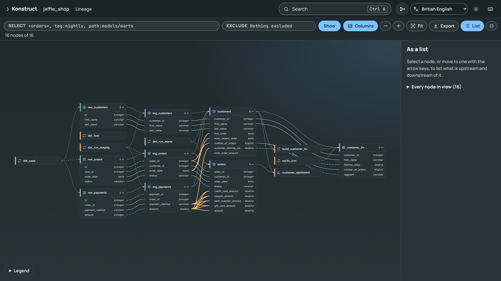

# The Graph Viewer

Every build writes `konstruct-out/graph.html`: one offline file that opens in any browser (`konstruct open`). It loads nothing from the network, so it can be attached to a ticket, published as a build artefact or opened on a laptop with no connection. The [live demo](https://kodexlabsio.github.io/konstruct/demo/) is the viewer for the jaffle_shop example, built with each version of these pages.

## What It Shows

- **Tables, models and tasks in dependency order**, from sources on the left to dashboards on the right. Cards expand to list their columns and types.
- **Column lineage drawn between columns.** Selecting a column shows its whole path on its own, fitted to the screen, with column-to-column edges and the joins and filters that use it. **Upstream**, **Both** and **Downstream** choose the direction.
- **Formulas.** The panel shows a column's SQL with CTEs and aliases inlined, the same formula in terms of source columns (see [Explaining a Column](explain.md)), and the joins, filters and grouping that shape its model's rows.
- **Verification.** After `konstruct verify`, confirmed column edges are marked and the share verified on data is shown (see [How Much to Trust the Lineage](verify.md)).
- **Business terms.** Search finds terms by name and synonym; a term's panel shows its definition, owner, status and bound columns, highlighted on the canvas (see [Business Definitions](definitions.md)).
- **Usage.** With usage on, a column shows how often it was queried (see [Column Usage](usage.md)).
- **Commands to ask next**, such as `konstruct explain` and `konstruct impact` for the selection, ready to copy.

With **Columns** on, the page is a column-level map of the whole project:

## Working With It

| Key | Action |
|-----|--------|
| `/` | Search tables, columns and business terms |
| `F` | Fit the graph to the window |
| `I` | Isolate the lineage of the selection |
| `C` | Show every column |
| `+`, `-` | Zoom |
| `Esc` | Clear the selection |

- **Links.** The address follows the selection (`graph.html#model.shop.orders%23amount`), so a link opens straight on a table, column or term.
- **Large projects.** Selecting anything in a graph of more than 120 tables isolates its lineage automatically, and a minimap shows where you are. A 2,000-model graph opens in under half a second.
- **Themes.** Dark and light, following the system setting, switchable from the toolbar.

The viewer is a Svelte and TypeScript app in `viewer/`; see [Development](../development.md) for how it is built and tested.
