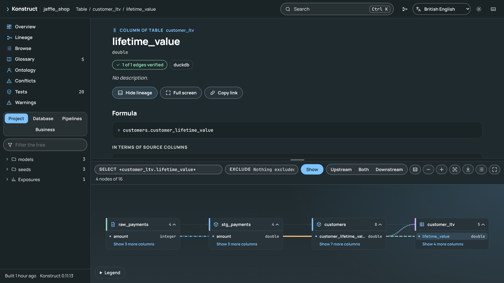

# Konstruct


**Column-level lineage for dbt, SQL, Airflow and Dagster: explained as formulas, checked against the data, and reviewed on every pull request.**

Konstruct reads a data repository and its warehouse and builds a graph of every table, column, model, task, test and dashboard, with column-level lineage parsed from the SQL that connects them. It runs locally in one command, with no server and no account, and answers from the command line, a Python API, an MCP server, skills and a Claude Code plugin for coding agents, a GitHub Action, and a single offline HTML page.

What it does that lineage tools usually leave out:

- **It shows how a column is calculated.** `konstruct explain` composes a column's SQL through every model upstream, so `customer_ltv.lifetime_value` reads as `SUM(raw_payments.amount / 100)`, with the joins and filters of each step listed beside it. A test evaluates composed formulas on the data and checks they give the model's values row for row. [Explaining a Column](guide/explain.md)
- **It checks its lineage against the data.** `konstruct verify` perturbs each input column, reruns each model and records which outputs change. On dbt Labs' jaffle-shop all 87 claimed column edges are confirmed, and nothing changed that the graph did not predict. [How Much to Trust the Lineage](guide/verify.md)
- **It reviews pull requests column by column.** `uses: kodexlabsio/konstruct@v0` comments with what a change does to each column, ignoring formatting and renamed CTEs, and fails the check when a removed column is still read downstream. It also prints a `dbt build --select` for only what the change affects. [Reviewing Changes](guide/reviewing-changes.md)
- **One chain across tools.** A column computed in dbt, copied by an Airflow SQL task, written by a Dagster asset and shown on a dashboard is one lineage chain, through DuckDB, Postgres, Snowflake, BigQuery, Databricks, Trino and Iceberg.
- **It handles large projects.** 2,000 models and 52,000 column edges build in 37 seconds on a four-core cloud machine and update in 7; queries answer in milliseconds. [Performance](performance.md)
- **It finds columns by meaning.** A search for "revenue" finds a column called `net_sales_amt`, through the abbreviations and synonyms of data work, its formula and its lineage, with exact names still first. Everything is computed locally from the graph. [Searching by Meaning](guide/search.md)
- **It derives an ontology.** The business objects, their keys and relations, the measures with their verified formulas, and how the objects relate, read from the code and tests and written to `ontology.yml` on every build. [The Ontology](guide/ontology.md)
- **It exports open formats.** OpenLineage events validated against the specification, Mermaid, Graphviz and CSV. [Exporting](guide/exporting.md)



## Start Here

- [Getting Started](getting-started.md): install Konstruct and build a graph in a minute.
- [The Graph Viewer](guide/viewer.md): the single-file page Konstruct writes with every build.
- [The GitHub Action](guide/github-action.md): review pull requests column by column.
- [Command Line](reference/cli.md) and [Python API](reference/python-api.md): every command and class.
- [The paper](https://kodexlabsio.github.io/konstruct/paper/konstruct.pdf): the design, verification by perturbation and its soundness, and the evaluation, rebuilt from the code with these pages.
- [The manifesto](https://github.com/kodexlabsio/konstruct/blob/main/MANIFESTO.md): what Konstruct believes about truth in data, and the commitments it makes to its users.

```{toctree}
:hidden:
:caption: Introduction

getting-started
performance
```

```{toctree}
:hidden:
:caption: Guide

guide/inputs
guide/viewer
guide/explain
guide/search
guide/verify
guide/reviewing-changes
guide/github-action
guide/definitions
guide/ontology
guide/ontology-packs
guide/ossie
guide/conflicts
guide/usage
guide/exporting
guide/agents
guide/plugins
```

```{toctree}
:hidden:
:caption: Reference

reference/cli
reference/python-api
reference/mcp
reference/configuration
reference/outputs
reference/limitations
```

```{toctree}
:hidden:
:caption: Project

development
contributing
security
changelog
```
