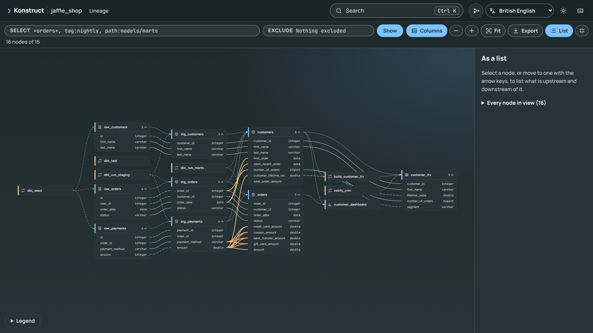

# Outputs and the Graph Format

| File | Contents |
|------|----------|
| `graph.json` | Nodes (`source`, `table`, `column`, `model`, `seed`, `snapshot`, `dag`, `task`, `test`, `exposure`, `term`) and edges (below), with descriptions, types, file paths and the inputs each came from |
| `REPORT.md` | Summary and coverage, the most queried columns (with usage on), business terms, the most used columns, orphans, untested models, columns with no lineage, columns documented in dbt but missing from the warehouse, and warnings |
| `ontology.yml` | The entities, measures, relationships and rules derived from the graph (see [The Ontology](../guide/ontology.md)); `konstruct verify` refreshes its verified counts |
| `graph.html` | A single offline file (open it with `konstruct open`): tables, models and tasks in dependency order; cards that expand to their columns; column lineage drawn between columns, isolated and fitted to the screen; each column's formula in terms of its sources; the conditions that shape each model; verification results; search, deep links to any table or column, dark and light themes |

| Edge | Direction | Meaning |
|------|-----------|---------|
| `contains` | relation to column | The column belongs to the relation |
| `feeds` | upstream to downstream | Relation to relation, task to the table it writes, table to the task that reads it. With `role: reference`, a column the target uses in a JOIN, WHERE, GROUP BY, HAVING or QUALIFY |
| `derived_from` | column to the column it comes from | Column-level lineage, with `transform: direct` or `transformed` |
| `runs` | DAG to task, task to dbt node | What a DAG or task executes |
| `precedes` | task to task | Airflow ordering, Dagster op and asset ordering, and sensors that start one job after another |
| `tests` | test to relation or column | What a dbt test checks |
| `defines` | term to column or relation | The column that holds a business term |
| `relates_to` | term to term | Related business terms |

With **Columns** on, graph.html is a column-level map of the whole project:

